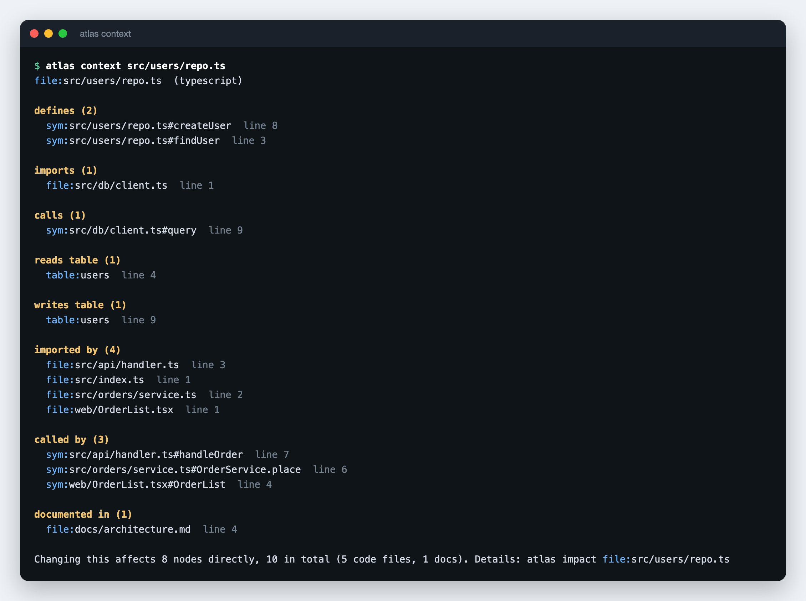
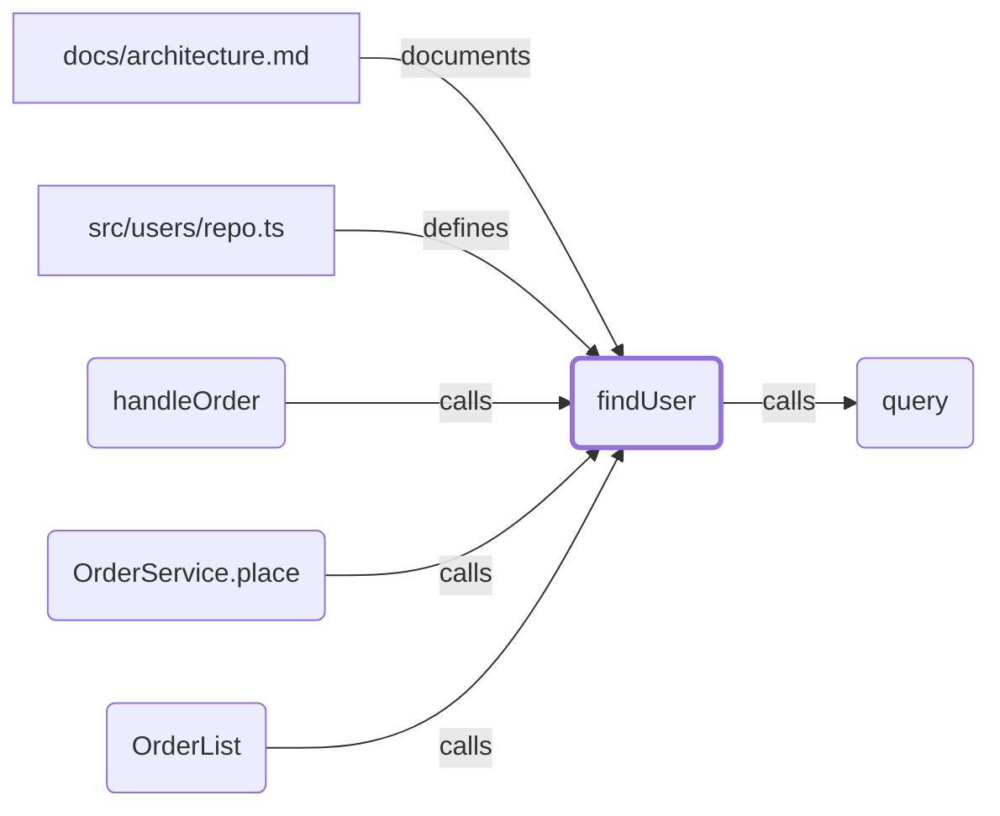

# Repo Atlas

[English](README.md) · **한국어**

> 이 문서는 [README.md](README.md)의 한국어 번역입니다. 두 문서가 다르면 영문이 기준입니다.

저장소의 파일, 함수, SQL 테이블, 환경변수 키, 문서가 서로 어떻게 이어져 있는지 지도로 만들어 주는 로컬 CLI입니다. 코드를 고치기 전에 사람이나 AI 코딩 에이전트가 **"이건 무엇과 닿아 있고, 바꾸면 무엇이 깨지는가?"** 를 물어볼 수 있습니다.

> **상태: 초기 개발 단계.**
> 무료 로컬 기능은 처음부터 끝까지 동작합니다. 저장소를 인덱싱하고(`atlas index`), 파일에 대한 브리핑을 받고(`atlas context`), 변경의 영향 범위를 추적하고(`atlas impact`), 그림으로 그리고(`atlas mermaid`), 에이전트가 같은 질문을 MCP로 하게 할 수 있습니다(`atlas mcp`).
> 아직 npm에 배포되지 않았습니다. 유료 플랜은 계획 단계입니다.

**바로가기:** [빠른 시작](#빠른-시작) · [사용법](#사용법) · [AI 에이전트에서 쓰기](#ai-에이전트에서-쓰기) · [설치](#설치)

## 개요

코딩 에이전트는 눈앞의 파일만 봐서는 보이지 않는 관계를 놓칠 때 엉뚱한 파일을 고칩니다. Python 작업도 같이 읽는 테이블, 모듈 세 곳이 의존하는 환경변수 키, 배럴 파일을 거쳐 다시 내보내지는 함수, 지금 바꾸는 코드를 설명하는 문서 같은 것들입니다.

Repo Atlas는 이런 관계를 질의할 수 있는 그래프 하나에 모아 둡니다.

1. tree-sitter로 저장소를 파싱해 파일마다 import, 함수, 호출, SQL 테이블, 환경변수 키, 문서 참조를 기록합니다.
2. 이 사실들을 그래프로 연결해 로컬 SQLite 파일(`.atlas/graph.db`)에 저장합니다.
3. CLI와 MCP 서버가 그래프에서 답합니다. 컨텍스트, 영향 범위, 경로, 다이어그램.

큰 코드베이스를 유지하는 팀과 AI 코딩 에이전트로 일하는 사람을 위해 만들었습니다.

### 실제 화면

아래 그림은 모두 실제 출력이며, 이 저장소에 들어 있는 작은 샘플 저장소 `fixtures/shop`(TypeScript, TSX, Python, SQL, Markdown)에서 캡처했습니다. 손댄 곳은 하나입니다. 긴 폴더 경로를 `~/shop`으로 줄였습니다.

**저장소 인덱싱** (Phase 1, 2). 두 번째 실행에서는 바뀐 파일이 없어서 아무것도 다시 파싱하지 않습니다.


**파일을 고치기 전 브리핑** (Phase 3). 무엇을 정의하고 쓰는지, 누가 이 파일을 쓰는지, 어떤 테이블을 건드리는지, 어떤 문서가 언급하는지 보여 줍니다.



**변경이 깨뜨릴 수 있는 것, 그리고 둘이 이어진 이유** (Phase 3). `users` 테이블은 TypeScript와 Python 스크립트 양쪽에서 읽히고, React 컴포넌트는 import 두 번을 거쳐 이 테이블에 닿습니다.


**함수 하나의 주변을 다이어그램으로** (`atlas mermaid --focus findUser`). GitHub이 바로 렌더링합니다.



**같은 그래프를 코딩 에이전트에게** (Phase 4). Model Context Protocol로 제공합니다.


**규칙은 지시문이 아니라 도구가 지킵니다** (Phase 0). 잘못된 레이어에서 SQLite에 손을 대는 편집은 대신 무엇을 해야 하는지와 함께 곧바로 에이전트에게 되돌아갑니다.


## 기능

| 기능 | 상태 |
|---|---|
| `atlas index`: TypeScript, TSX, JavaScript, Python을 tree-sitter로 추출 | 완료 |
| SQL 테이블: `.sql` 파일과 문자열 리터럴 안의 SQL을 정의 / 읽기 / 쓰기로 구분 | 완료 |
| 환경변수 키: `process.env.X`, `import.meta.env.X`, `os.environ`, `os.getenv`, 그리고 `.env.example`에 선언된 키 | 완료 |
| 문서: 파일, 함수, 테이블, 환경변수 키를 가리키는 Markdown 링크와 백틱 이름 | 완료 |
| import 해석: 상대 경로, `.js`→`.ts`, index 파일, tsconfig `paths` / `baseUrl`, 워크스페이스 패키지 이름, Python 패키지와 상대 import | 완료 |
| 호출 해석: named·default·namespace import, 배럴 re-export, `this` / `self`, JSX 컴포넌트 | 완료 |
| 증분 인덱싱: 바뀐 파일만 다시 파싱하고, 모든 질의가 먼저 인덱스를 갱신 | 완료 |
| `atlas context` / `impact` / `path` / `search` / `stats` / `export`, 모두 `--json` 지원 | 완료 |
| `atlas mermaid`: 파일 단위 전체 그림 또는 노드 하나의 주변 | 완료 |
| `atlas mcp`: 도구 6개를 가진 MCP 서버(stdio). `atlas init`이 `.mcp.json`에 등록 | 완료 |
| 로컬 SQLite 인덱스(내장 `node:sqlite`, 컴파일할 것 없음) | 완료 |
| npm 패키지 배포 | 예정 |
| 언어 추가(Go, Rust, Java, Ruby: 문법 파일은 의존성에 이미 포함) | 예정 |
| IDE 연동 | 예정 |
| 유료 플랜: private 저장소 호스티드 인덱싱, 팀 공유 그래프, CI 연동 | 계획중 |

### 동작 방식

- **추출**: 파일을 하나씩 따로 파싱해 단순한 사실(심볼, import, 호출, 테이블, 환경변수 키, 문서 참조)로 만듭니다. 한 파일의 사실은 그 파일에만 의존하므로, 바뀌지 않은 파일은 다시 파싱하지 않습니다.
- **연결**: 모든 파일의 사실을 노드(`file`, `symbol`, `table`, `env`, `module`)와 엣지(`imports`, `defines`, `calls`, `defines_table`, `reads_table`, `writes_table`, `uses_env`, `declares_env`, `documents`)로 잇습니다. 연결은 순수 함수이며 속성 기반 테스트로 검증합니다. 끊어진 엣지가 없고, 중복이 없고, 파일 순서와 무관하게 결과가 같습니다.
- **저장**: 사실과 그래프는 저장소 안의 `.atlas/graph.db`에, **사용자의 컴퓨터에만** 있습니다. 이 폴더는 스스로를 git에서 제외합니다. 컴퓨터 밖으로 나가는 것은 없습니다.
- **질의**: `impact`는 의존 엣지를 거꾸로 따라갑니다. 함수를 거치는 경로는 정밀하게(호출자의 호출자까지) 따라가고, import로 닿은 파일은 그 파일을 import하는 쪽으로 계속 따라갑니다.
- **AI를 쓰지 않습니다**: 그래프는 모델이 아니라 파싱으로 만듭니다. API 키가 필요 없고 네트워크 요청도 하지 않습니다.

### 인덱싱 대상

| 종류 | 파일 | 기록하는 것 |
|---|---|---|
| TypeScript / JavaScript | `.ts` `.tsx` `.mts` `.cts` `.js` `.jsx` `.mjs` `.cjs` | 최상위 함수, 클래스, 메서드. import, re-export, `require`, 동적 `import()`. 호출, `new`, JSX 컴포넌트 |
| Python | `.py` | 함수, 클래스, 메서드. `import` / `from … import`. 호출. `__tablename__` |
| SQL | `.sql`, 코드 문자열 안의 SQL | `CREATE` / `ALTER` / `INSERT` / `UPDATE` / `DELETE` / `FROM` / `JOIN` / `REFERENCES`, 그리고 `.from("table")` 쿼리 빌더 |
| 설정 | `.env.example`, `.env.sample`, `.env.template` | 키 이름만 읽고 값은 읽지 않습니다. 실제 `.env` 파일은 열지 않습니다. |
| 문서 | `.md` `.mdx` | 상대 링크와 `` `백틱` `` 이름 |

git 저장소 안에서는 파일 목록을 git에서 받으므로 `.gitignore`를 따릅니다. 그 밖에서는 흔한 산출물 폴더(`node_modules`, `dist`, `.venv` 등)를 건너뜁니다. 1 MiB가 넘는 파일은 건너뜁니다.

## 요구 사항

- Node.js **22.13 이상** (Node 24에서 개발). 내장 SQLite 모듈에 필요합니다.
- [pnpm](https://pnpm.io) 10 (소스에서 빌드할 때)
- Git (선택. 파일 목록과 저장소 루트를 찾는 데 씁니다)

## 설치

아직 npm에 배포되지 않았습니다. 소스에서 설치합니다.

```bash
git clone https://github.com/Trapa-Eureka/repo-atlas.git
cd repo-atlas
pnpm install
pnpm build
```

배포 전까지는 빌드 결과물로 실행합니다. 편하게 쓰려면 alias를 추가하세요(경로는 맞게 바꿉니다).

```bash
alias atlas='node /path/to/repo-atlas/dist/cli/main.js'
```

npm 배포는 예정되어 있습니다. 배포되면 다음 명령으로 설치할 수 있습니다.

```bash
npm install -g repo-atlas
```

## 빠른 시작

[설치](#설치)의 빌드와 `atlas` alias가 필요합니다. 그다음 아무 저장소에서나:

1. **인덱싱합니다.** `cd your-project` 후 `atlas index`. `.atlas/` 폴더가 생깁니다(스스로 git에서 제외되며 내 컴퓨터에만 있습니다).
2. **고치기 전에 물어봅니다.** `atlas context src/some/file.ts`는 그 파일이 무엇을 정의하고 쓰는지, 누가 쓰는지, 어떤 테이블과 환경변수 키를 건드리는지, 어떤 문서가 언급하는지 보여 줍니다.
3. **영향 범위를 확인합니다.** `atlas impact <파일 | 함수 | 테이블 | ENV_KEY>`는 거기에 의존하는 모든 것을 나열합니다.
4. **에이전트에게 줍니다.** `atlas init`이 MCP 서버를 `.mcp.json`에 등록합니다. 에이전트를 다시 시작하세요. [AI 에이전트에서 쓰기](#ai-에이전트에서-쓰기)를 보세요.

`atlas index`를 다시 실행할 필요는 없습니다. 모든 명령이 먼저 지난 실행 이후 바뀐 파일을 다시 파싱합니다.

## 사용법

모든 명령은 `-C <dir>`(다른 저장소에서 작업), `--json`(기계가 읽는 출력), `--no-refresh`(변경 확인 없이 저장된 인덱스로 답하기)를 받습니다.

| 하고 싶은 일 | 명령 |
|---|---|
| 인덱스를 만들거나 갱신 | `atlas index [dir]` (`--full`은 전부 다시 파싱) |
| 이름으로 노드 찾기 | `atlas search <query> [--kind file\|symbol\|table\|env\|module] [--limit n]` |
| 모든 테이블(또는 환경변수 키) 나열 | `atlas search "" --kind table` |
| 고치기 전 브리핑 받기 | `atlas context <target>` |
| 변경이 깨뜨릴 수 있는 것 보기 | `atlas impact <target> [--depth n]` |
| 두 대상이 어떻게 이어지는지 보기 | `atlas path <from> <to>` |
| 파일 단위 전체 그림 그리기 | `atlas mermaid [--max n] [-o graph.mmd]` |
| 노드 하나의 주변 그리기 | `atlas mermaid --focus <target> [--depth n]` |
| 그래프 크기, 허브 파일, 해석 못 한 import 보기 | `atlas stats [--unresolved]` |
| 그래프 전체 내보내기 | `atlas export [-o graph.json]` |

### 대상(target) 지정

`<target>`에는 다음을 쓸 수 있습니다.

- 파일 경로. 저장소 루트 기준이든 현재 위치 기준이든 됩니다: `src/users/repo.ts`, 또는 뒷부분만 `users/repo.ts`
- 함수, 클래스, 메서드 이름: `findUser`, `OrderService.place`
- 특정 파일의 심볼: `src/users/repo.ts#findUser`
- 테이블, 환경변수 키, 패키지 이름: `users`, `DATABASE_URL`, `react`
- 다른 명령이 출력한 노드 id: `sym:src/users/repo.ts#findUser`, `table:users`

이름이 노드 여러 개와 맞으면 후보를 출력하고 종료 코드 `2`로 끝납니다. id 중 하나를 고르세요. 그 밖의 오류는 `1`로 끝납니다.

### `impact` 읽는 법

각 줄 끝에는 그 노드가 나온 이유가 붙습니다: `[calls X]`, `[imports X]`, `[reads_table X]`, `[documents X]`. `[contains X]`는 영향받는 함수가 들어 있는 파일이라는 표시입니다. 영향받는 노드를 언급하는 문서는 고칠 수 있도록 나열하지만, 그 문서에서 더 따라가지는 않습니다.

### 이 저장소 개발하기

```bash
pnpm check        # 타입체크 + 린트 + 테스트 + 훅 테스트: 변경이 통과해야 하는 것
pnpm build        # dist/ 로 컴파일
pnpm test         # 추출기, 링커(속성 기반), CLI, MCP 테스트
pnpm test:hooks   # 개발용 훅 테스트
```

## AI 에이전트에서 쓰기

`atlas mcp`는 stdin/stdout으로 [Model Context Protocol](https://modelcontextprotocol.io) 서버를 실행합니다. 저장소마다 한 번 등록합니다.

```bash
atlas init        # .mcp.json에 "repo-atlas"를 추가하고 다른 서버는 그대로 둡니다
```

직접 적어도 됩니다.

```json
{
  "mcpServers": {
    "repo-atlas": { "command": "atlas", "args": ["mcp"] }
  }
}
```

`atlas` 명령이 에이전트의 `PATH`에 있어야 합니다. 패키지가 배포되기 전까지는 `"command": "atlas", "args": ["mcp"]`를 `"command": "node", "args": ["/path/to/repo-atlas/dist/cli/main.js", "mcp"]`로 바꾸세요.

| 도구 | 답하는 질문 |
|---|---|
| `atlas_search` | 이 이름을 가진 노드는? |
| `atlas_context` | 이걸 고치기 전에 무엇을 알아야 하나? |
| `atlas_impact` | 무엇이 여기에 의존하고, 어떤 문서가 언급하나? |
| `atlas_path` | 이 둘은 어떻게 이어져 있나? |
| `atlas_mermaid` | 그래프의 이 부분을 그려 줘 |
| `atlas_stats` | 그래프 크기, 허브 파일, 해석 못 한 import는? |

도구 호출마다 먼저 바뀐 파일을 다시 인덱싱하므로, 답은 에이전트가 고치고 있는 작업 트리와 일치합니다. MCP가 없는 에이전트는 CLI를 `--json`으로 호출하면 됩니다.

## 알려진 한계

- **호출은 타입이 아니라 이름과 import로 해석합니다.** 인스턴스에서 부르는 메서드(`const s = new Service(); s.run()`), 체이닝 호출(`a.b().c()`), 동적 디스패치는 따라가지 않습니다. 해석할 수 없는 호출은 추측하지 않고 뺍니다. 그래서 그래프는 엣지를 지어내는 대신 놓치는 쪽입니다.
- **SQL 탐지는 패턴 기반입니다.** SQL 텍스트를 읽습니다. 문자열을 이어 붙여 만든 쿼리나 ORM(Prisma, Drizzle, SQLAlchemy 표현식)이 만든 쿼리는 보지 못합니다. `.from("name")` 호출은 모두 테이블 읽기로 보는데, 쿼리 빌더가 아닌 라이브러리라면 틀릴 수 있습니다.
- tsconfig의 `extends`는 따라가지 않고, `package.json`의 `exports` 맵은 읽지 않습니다. 워크스페이스 패키지는 `src/index`, `index`, 또는 `main` 파일로 해석합니다.
- Python 절대 import는 저장소 루트에서 먼저 찾고, 없으면 유일한 경로 접미사로 찾습니다. 모듈 경로가 같은 패키지가 둘이면 해석하지 않습니다.
- 문서는 상대 링크와 백틱 이름으로만 연결합니다. 백틱 안의 흔한 단어가 마침 그 이름을 가진 유일한 함수라면 연결됩니다.
- 최상위 함수, 클래스, 그 메서드만 심볼입니다. 중첩 함수는 그것을 감싼 함수의 것으로 칩니다.
- 번들된 샘플 저장소와 파일 171개짜리 TypeScript 모노레포 한 곳에서 확인했습니다(0.5초 안에 인덱싱, 해석 못 한 import 없음). 더 크고 다양한 저장소에서는 아직 써 보지 않았습니다.
- macOS에서 개발했습니다. Linux는 동작할 것으로 보이고 Windows는 테스트하지 않았습니다. Node 내장 SQLite는 아직 Node에서 실험 기능으로 표시되어 있으며, `atlas`는 그 시작 경고를 숨깁니다.

## 유료 플랜 (계획중)

내 컴퓨터에서 도는 것은 모두 무료이고 앞으로도 무료입니다. 인덱싱, 모든 질의, 다이어그램, MCP 서버가 여기에 들어갑니다. 서버가 필요한 기능(private 저장소 호스티드 인덱싱, 팀이 함께 보는 그래프, CI 연동)의 유료 플랜은 계획 단계입니다. 아직 판매하는 것은 없고, 가격과 세부 사항도 정해지지 않았습니다.

## 에이전트 하네스

이 저장소는 AI 코딩 에이전트와 함께 개발하며, 규칙은 긴 지시 파일이 아니라 도구로 강제합니다.

- **`CLAUDE.md`는 짧습니다.** 코드만 봐서는 에이전트가 알 수 없는 것만 담습니다.
- **아키텍처는 린트 규칙이 지킵니다** (`eslint.config.js`). 어느 레이어가 어느 레이어를 import할 수 있는지, 그리고 SQLite·tree-sitter·인자 파서·MCP SDK는 각각 한 레이어만 만질 수 있다는 규칙입니다. 메시지마다 대신 무엇을 해야 하는지 적혀 있습니다.
- **훅** (`.claude/settings.json`, 스크립트와 테스트는 `.claude/hooks/`):
  - `PreToolUse`는 되돌리기 어려운 동작을 막습니다. 넓은 범위의 재귀 삭제, 강제 푸시, `reset --hard`, 비밀·인덱스 파일 스테이징, 파괴적 SQL, `curl | sh`, `npm publish`, 키 모양 문자열을 파일에 쓰는 것.
  - `PostToolUse`는 방금 고친 파일을 린트하고 위반을 에이전트에게 돌려보냅니다(종료 코드 2).
  - `Stop`은 코드가 바뀌었으면 타입체크와 테스트를 돌리고, 실패한 채로는 턴이 끝나지 않게 합니다.
- **거부(deny) 규칙**은 실제 env 파일을 읽지 못하게 하고, 배포는 사람 손에 둡니다.
- **스킬** (`.claude/skills/`)에는 가끔만 필요한 절차가 있습니다. 언어 추가, 그리고 실제 CLI 출력으로 변경을 증명하는 방법.
- **새 눈의 리뷰어** (`.claude/agents/fresh-reviewer.md`)는 변경이 어떻게 작성됐는지 보지 않은 상태에서 리뷰합니다.

훅은 안전망이지 완전한 방어가 아닙니다. 명령 텍스트를 맞춰 보는 방식이라, 감싸거나 난독화한 명령은 빠져나갈 수 있고, 위험해 보이는 문자열이 들어 있을 뿐인 무해한 명령이 막힐 수 있습니다.

## 데이터와 프라이버시

- 인덱스(`.atlas/`)는 내 컴퓨터에 남습니다. 폴더 안에 자체 `.gitignore`가 있어 실수로 커밋되지 않습니다.
- 인덱스에는 파일 경로, 심볼 이름, 테이블 이름, 환경변수 키 **이름**이 들어갑니다. 파일 내용이나 환경변수 값은 들어가지 않습니다.
- 실제 env 파일(`.env`, `.env.local` 등)은 열지 않습니다. `.env.example` 같은 템플릿만 읽습니다.
- 텔레메트리도, 네트워크 요청도, API 키도 없습니다.

## 프로젝트 구조

```
repo-atlas/
├── src/
│   ├── graph/     # 노드·엣지 타입, 메모리 내 그래프
│   ├── extract/   # 파일 하나 -> 사실 (tree-sitter, SQL, env, Markdown)
│   ├── indexer/   # 파일 목록, import 별칭, 사실을 그래프로 연결, 증분 인덱싱
│   ├── store/     # SQLite (SQL을 아는 유일한 모듈)
│   ├── query/     # search, context, impact, path, mermaid, stats (메모리 내 그래프 위의 순수 함수)
│   ├── app/       # Atlas: CLI와 MCP 서버가 함께 부르는 것
│   ├── mcp/       # MCP 서버
│   └── cli/       # `atlas` 명령
├── test/          # 추출기, 링커(속성 기반), CLI, MCP 테스트
├── fixtures/shop/ # 테스트가 인덱싱하는 샘플 저장소
├── assets/        # README 스크린샷과 소셜 프리뷰 이미지
├── scripts/       # assets/ 이미지를 다시 만드는 스크립트 (`pnpm screenshots`)
├── .claude/
│   ├── settings.json
│   ├── hooks/     # 개발용 훅과 테스트
│   ├── skills/    # add-language, verify-change
│   └── agents/    # fresh-reviewer
├── CLAUDE.md      # 이 저장소에서 일하는 AI 에이전트를 위한 짧은 안내
└── eslint.config.js  # 레이어 경계
```

### 기술 스택

TypeScript(ESM), Node.js 22+ · 미리 빌드된 WASM 문법을 쓰는 [web-tree-sitter](https://github.com/tree-sitter/tree-sitter)(네이티브 빌드 없음) · 내장 `node:sqlite` · [commander](https://github.com/tj/commander.js) · [MCP TypeScript SDK](https://github.com/modelcontextprotocol/typescript-sdk) · Vitest와 [fast-check](https://github.com/dubzzz/fast-check) · ESLint · pnpm

## 로드맵

- [x] **Phase 0**: 하네스: 짧은 `CLAUDE.md`, 훅, 린트로 강제하는 레이어, 샘플 저장소
- [x] **Phase 1**: 추출: TypeScript / JavaScript / Python, SQL, 환경변수 키, Markdown
- [x] **Phase 2**: 그래프: 연결, SQLite 저장소, 증분 인덱싱
- [x] **Phase 3**: 질의와 CLI: `search`, `context`, `impact`, `path`, `mermaid`, `stats`, `export`
- [x] **Phase 4**: 에이전트: MCP 서버, `atlas init`
- [ ] **Phase 5**: 릴리스: npm 패키지, 언어 추가, IDE 연동
- [ ] **Phase 6**: 유료 플랜: private 저장소 호스티드 인덱싱, 팀 공유 그래프, CI 연동 (계획중)

## 기여

프로젝트는 초기 단계입니다. 풀 리퀘스트를 보내기 전에 이슈를 열어 변경 내용을 먼저 논의해 주세요. 이 저장소의 파일은 모두 영어로 작성하며, 이 문서만 한국어 번역입니다.

## 라이선스

[MIT](LICENSE).
