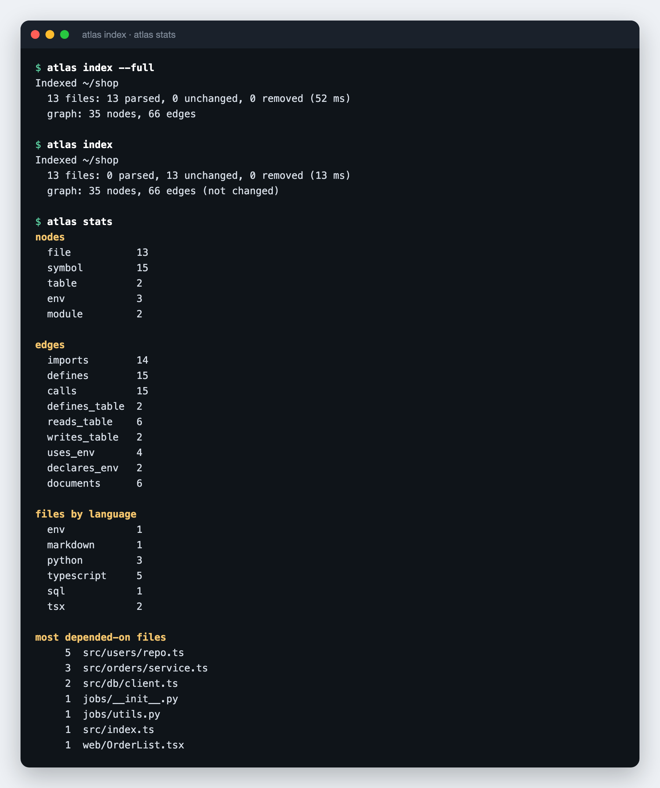
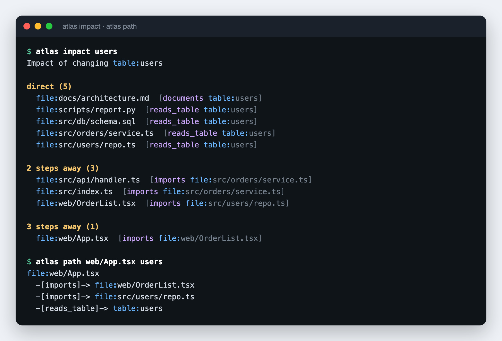
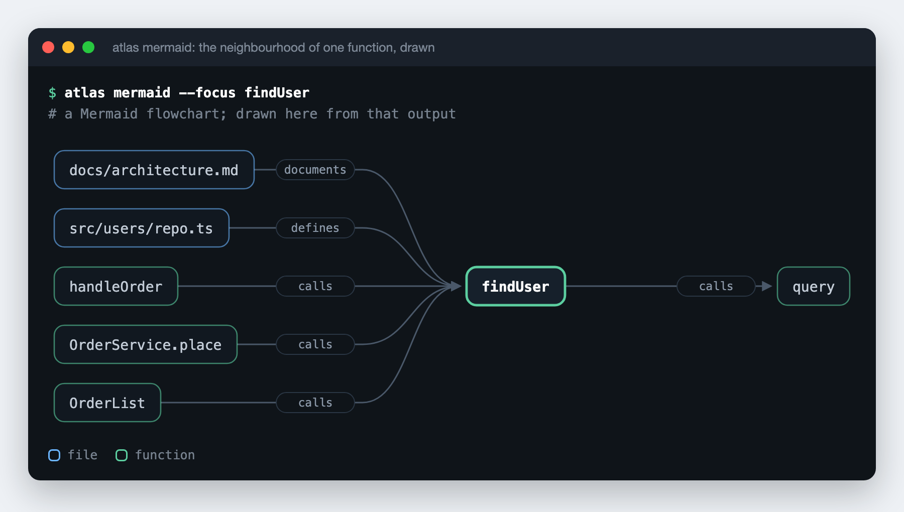
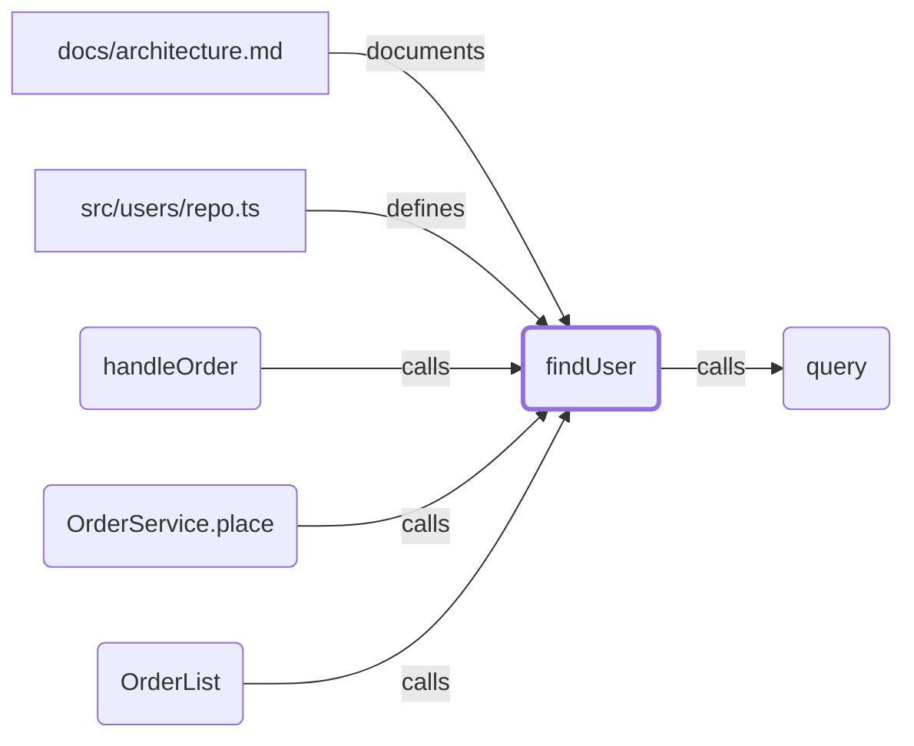
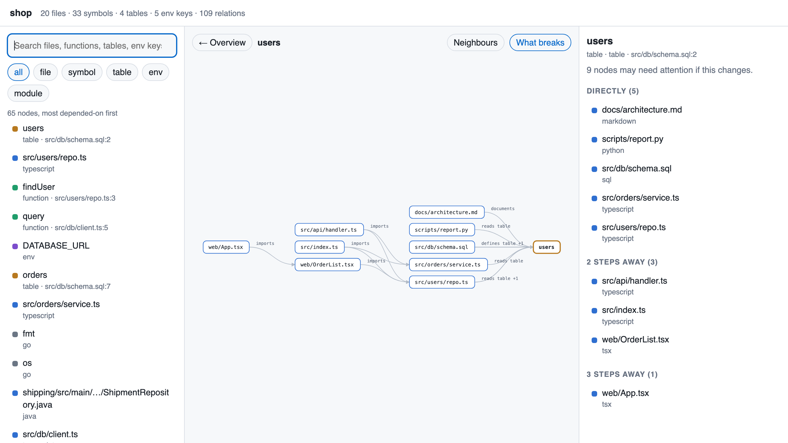
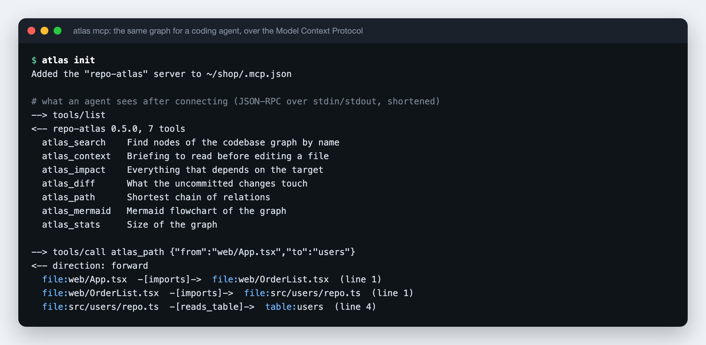
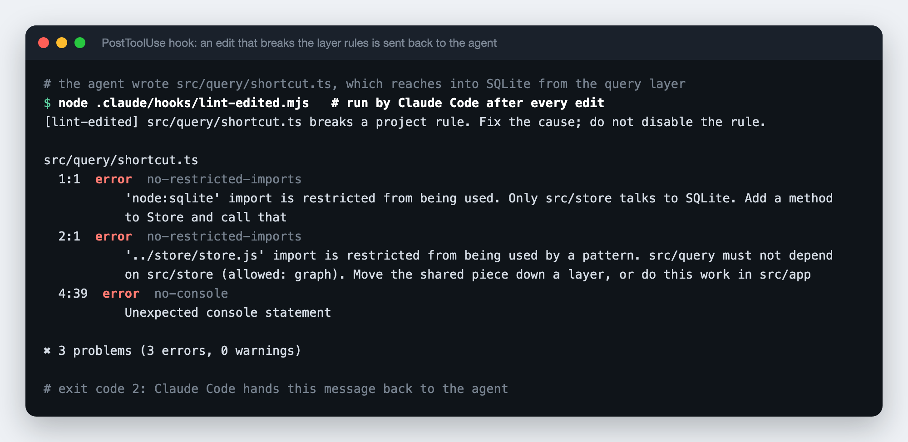

# Repo Atlas

[English](README.md) · **한국어**

> 이 문서는 [README.md](README.md)의 한국어 번역입니다. 두 문서가 다르면 영문이 기준입니다.

저장소의 파일, 함수, SQL 테이블, 환경변수 키, 문서가 서로 어떻게 이어져 있는지 지도로 만들어 주는 로컬 CLI입니다. 코드를 고치기 전에 사람이나 AI 코딩 에이전트가 **"이건 무엇과 닿아 있고, 바꾸면 무엇이 깨지는가?"** 를 물어볼 수 있습니다.

> **상태: 초기 개발 단계.**
> 무료 로컬 기능은 처음부터 끝까지 동작합니다. 저장소를 인덱싱하고(`atlas index`), 파일에 대한 브리핑을 받고(`atlas context`), 변경의 영향 범위를 추적하고(`atlas impact`), 그림으로 그리고(`atlas mermaid`), 에이전트가 같은 질문을 MCP로 하게 할 수 있습니다(`atlas mcp`).
> npm에 [`repo-atlas-cli`](https://www.npmjs.com/package/repo-atlas-cli)로 배포되어 있습니다. 유료 플랜은 계획 단계입니다.

**바로가기:** [빠른 시작](#빠른-시작) · [사용법](#사용법) · [AI 에이전트에서 쓰기](#ai-에이전트에서-쓰기) · [설치](#설치)

## 개요

코딩 에이전트는 눈앞의 파일만 봐서는 보이지 않는 관계를 놓칠 때 엉뚱한 파일을 고칩니다. Python 작업도 같이 읽는 테이블, 모듈 세 곳이 의존하는 환경변수 키, 배럴 파일을 거쳐 다시 내보내지는 함수, 지금 바꾸는 코드를 설명하는 문서 같은 것들입니다.

Repo Atlas는 이런 관계를 질의할 수 있는 그래프 하나에 모아 둡니다.

1. tree-sitter로 저장소를 파싱해 파일마다 import, 함수, 호출, SQL 테이블, 환경변수 키, 문서 참조를 기록합니다.
2. 이 사실들을 그래프로 연결해 로컬 SQLite 파일(`.atlas/graph.db`)에 저장합니다.
3. CLI와 MCP 서버가 그래프에서 답합니다. 컨텍스트, 영향 범위, 경로, 다이어그램.

큰 코드베이스를 유지하는 팀과 AI 코딩 에이전트로 일하는 사람을 위해 만들었습니다.

### 실제 화면

아래 그림은 모두 실제 출력이며, 이 저장소에 들어 있는 작은 샘플 저장소 `fixtures/shop`(TypeScript, TSX, Python, Go, Java, Rust, Ruby, SQL, Markdown)에서 캡처했습니다. 손댄 곳은 하나입니다. 긴 폴더 경로를 `~/shop`으로 줄였습니다.

**저장소 인덱싱** (Phase 1, 2). 두 번째 실행에서는 바뀐 파일이 없어서 아무것도 다시 파싱하지 않습니다.



**파일을 고치기 전 브리핑** (Phase 3). 무엇을 정의하고 쓰는지, 누가 이 파일을 쓰는지, 어떤 테이블을 건드리는지, 어떤 문서가 언급하는지 보여 줍니다.


**변경이 깨뜨릴 수 있는 것, 그리고 둘이 이어진 이유** (Phase 3). `users` 테이블은 TypeScript와 Python 스크립트 양쪽에서 읽히고, React 컴포넌트는 import 두 번을 거쳐 이 테이블에 닿습니다.



**함수 하나의 주변을 다이어그램으로** (`atlas mermaid --focus findUser`). 이 명령은 Mermaid 플로차트를 출력하고, GitHub·GitLab과 대부분의 에디터가 이를 그림으로 보여 줍니다. 아래는 그 출력을 그린 것입니다.



<details>
<summary>명령의 Mermaid 출력</summary>



</details>

**브라우저에서 보는 전체 그래프** (`atlas view`). 인덱스 옆에 HTML 파일 하나를 만듭니다. 검색, 노드 주변 보기, 바뀌면 깨지는 것 보기가 들어 있고, 네트워크에서 아무것도 불러오지 않습니다.



**같은 그래프를 코딩 에이전트에게** (Phase 4). Model Context Protocol로 제공합니다.



**규칙은 지시문이 아니라 도구가 지킵니다** (Phase 0). 잘못된 레이어에서 SQLite에 손을 대는 편집은 대신 무엇을 해야 하는지와 함께 곧바로 에이전트에게 되돌아갑니다.



## 기능

| 기능 | 상태 |
|---|---|
| `atlas index`: TypeScript, TSX, JavaScript, Python, Go, Java, Rust, Ruby를 tree-sitter로 추출 | 완료 |
| SQL 테이블: `.sql` 파일과 문자열 리터럴 안의 SQL을 정의 / 읽기 / 쓰기로 구분 | 완료 |
| 환경변수 키: `process.env.X`, `import.meta.env.X`, `os.environ`, `os.getenv`, `os.Getenv`, `System.getenv`, `env::var` / `env!`, `ENV["X"]` / `ENV.fetch`, 그리고 `.env.example`에 선언된 키 | 완료 |
| 문서: 파일, 함수, 테이블, 환경변수 키를 가리키는 Markdown 링크와 백틱 이름 | 완료 |
| import 해석: 상대 경로, `.js`→`.ts`, index 파일, tsconfig `paths` / `baseUrl`, 워크스페이스 패키지 이름, Python 패키지와 상대 import, Go 모듈 경로(`go.mod`), Java 패키지, Rust 모듈과 크레이트(`Cargo.toml`), Ruby `require`와 이름으로 쓰는 클래스 | 완료 |
| 호출 해석: named·default·namespace import, 배럴 re-export, `this` / `self`, JSX 컴포넌트 | 완료 |
| 증분 인덱싱: 바뀐 파일만 다시 파싱하고, 모든 질의가 먼저 인덱스를 갱신 | 완료 |
| `atlas context` / `impact` / `path` / `search` / `stats` / `export`, 모두 `--json` 지원 | 완료 |
| `atlas mermaid`: 파일 단위 전체 그림 또는 노드 하나의 주변 | 완료 |
| `atlas view`: 그래프를 브라우저에서 탐색하는 HTML 페이지 하나로 저장 (서버 없음) | 완료 |
| `atlas mcp`: 도구 6개를 가진 MCP 서버(stdio). `atlas init`이 Claude Code, VS Code, Cursor, Devin(Windsurf), JetBrains에 등록 | 완료 |
| 로컬 SQLite 인덱스(내장 `node:sqlite`, 컴파일할 것 없음) | 완료 |
| npm 패키지 배포 (`repo-atlas-cli`) | 완료 |
| 유료 플랜: private 저장소 호스티드 인덱싱, 팀 공유 그래프, CI 연동 | 계획중 |

### 동작 방식

- **추출**: 파일을 하나씩 따로 파싱해 단순한 사실(심볼, import, 호출, 테이블, 환경변수 키, 문서 참조)로 만듭니다. 한 파일의 사실은 그 파일에만 의존하므로, 바뀌지 않은 파일은 다시 파싱하지 않습니다.
- **연결**: 모든 파일의 사실을 노드(`file`, `symbol`, `table`, `env`, `module`)와 엣지(`imports`, `defines`, `calls`, `defines_table`, `reads_table`, `writes_table`, `uses_env`, `declares_env`, `documents`)로 잇습니다. 연결은 순수 함수이며 속성 기반 테스트로 검증합니다. 끊어진 엣지가 없고, 중복이 없고, 파일 순서와 무관하게 결과가 같습니다.
- **저장**: 사실과 그래프는 저장소 안의 `.atlas/graph.db`에, **사용자의 컴퓨터에만** 있습니다. 이 폴더는 스스로를 git에서 제외합니다. 컴퓨터 밖으로 나가는 것은 없습니다.
- **질의**: `impact`는 의존 엣지를 거꾸로 따라갑니다. 함수를 거치는 경로는 정밀하게(호출자의 호출자까지) 따라가고, import로 닿은 파일은 그 파일을 import하는 쪽으로 계속 따라갑니다.
- **AI를 쓰지 않습니다**: 그래프는 모델이 아니라 파싱으로 만듭니다. API 키가 필요 없고 네트워크 요청도 하지 않습니다.

### 인덱싱 대상

| 종류 | 파일 | 기록하는 것 |
|---|---|---|
| TypeScript / JavaScript | `.ts` `.tsx` `.mts` `.cts` `.js` `.jsx` `.mjs` `.cjs` | 최상위 함수, 클래스, 메서드. import, re-export, `require`와 `module.exports`, 동적 `import()`. 호출, `new`, JSX 컴포넌트 |
| Python | `.py` | 함수, 클래스, 메서드. `import` / `from … import`. 호출. `__tablename__` |
| Go | `.go` | 함수, 메서드, 타입. `go.mod`로 해석하는 import. 호출(타입이 적힌 값과 구조체 필드의 메서드 포함) |
| Java | `.java` | 클래스, 인터페이스, enum, record와 그 메서드. import와 같은 패키지 사용. 필드·매개변수·상속을 거친 호출. `@Table` |
| Rust | `.rs` | 함수, 구조체, enum, 트레이트, `impl` 메서드. `mod`와 `use` 경로, 글롭, `pub use`. 경로 호출, 타입이 적힌 값의 메서드, 매크로 안의 호출 |
| Ruby | `.rb` `.rake` | 클래스, 모듈과 그 메서드, 최상위 메서드. `require`, `require_relative`, `autoload`, 이름으로 쓰는 클래스. `self`, 클래스, `.new`로 만든 값에 대한 호출. `create_table`, Active Record 모델의 테이블 |
| SQL | `.sql`, 코드 문자열 안의 SQL | `CREATE` / `ALTER` / `INSERT` / `UPDATE` / `DELETE` / `FROM` / `JOIN` / `REFERENCES`, 그리고 `.from("table")` 쿼리 빌더 |
| 설정 | `.env.example`, `.env.sample`, `.env.template` | 키 이름만 읽고 값은 읽지 않습니다. 실제 `.env` 파일은 열지 않습니다. |
| 문서 | `.md` `.mdx` | 상대 링크와 `` `백틱` `` 이름 |

git 저장소 안에서는 파일 목록을 git에서 받으므로 `.gitignore`를 따르고, 커밋된 `build/`나 `vendor/` 폴더도 다른 소스처럼 인덱싱합니다(`node_modules`는 항상 제외). 그 밖에서는 흔한 산출물 폴더(`node_modules`, `dist`, `.venv` 등)를 건너뜁니다. 1 MiB가 넘는 파일은 건너뜁니다.

## 요구 사항

- Node.js **22.13 이상** (Node 24에서 개발). 내장 SQLite 모듈에 필요합니다.
- [pnpm](https://pnpm.io) 10 (소스에서 빌드할 때만)
- Git (선택. 파일 목록과 저장소 루트를 찾는 데 씁니다)

## 설치

```bash
npm install -g repo-atlas-cli
atlas --version
```

패키지 이름은 `repo-atlas-cli`이고, 설치되는 명령은 `atlas`입니다. 설치 없이 써 보려면 `npx repo-atlas-cli index`를 실행합니다.

소스에서 빌드하려면 다음과 같이 합니다.

```bash
git clone https://github.com/Trapa-Eureka/repo-atlas.git
cd repo-atlas
pnpm install
pnpm build
alias atlas='node /path/to/repo-atlas/dist/cli/main.js'   # 경로는 맞게 바꿉니다
```

## 빠른 시작

[설치](#설치)의 빌드와 `atlas` alias가 필요합니다. 그다음 아무 저장소에서나:

1. **인덱싱합니다.** `cd your-project` 후 `atlas index`. `.atlas/` 폴더가 생깁니다(스스로 git에서 제외되며 내 컴퓨터에만 있습니다).
2. **고치기 전에 물어봅니다.** `atlas context src/some/file.ts`는 그 파일이 무엇을 정의하고 쓰는지, 누가 쓰는지, 어떤 테이블과 환경변수 키를 건드리는지, 어떤 문서가 언급하는지 보여 줍니다.
3. **영향 범위를 확인합니다.** `atlas impact <파일 | 함수 | 테이블 | ENV_KEY>`는 거기에 의존하는 모든 것을 나열합니다.
4. **에이전트에게 줍니다.** `atlas init`이 MCP 서버를 `.mcp.json`에 등록합니다(`--client`로 다른 에이전트를 고릅니다). 에이전트를 다시 시작하세요. [AI 에이전트에서 쓰기](#ai-에이전트에서-쓰기)를 보세요.

`atlas index`를 다시 실행할 필요는 없습니다. 모든 명령이 먼저 지난 실행 이후 바뀐 파일을 다시 파싱합니다.

## 사용법

모든 명령은 `-C <dir>`(다른 저장소에서 작업), `--json`(기계가 읽는 출력), `--no-refresh`(변경 확인 없이 저장된 인덱스로 답하기)를 받습니다.

| 하고 싶은 일 | 명령 |
|---|---|
| 인덱스를 만들거나 갱신 | `atlas index [dir]` (`--full`은 전부 다시 파싱) |
| 이름으로 노드 찾기 | `atlas search <query> [--kind file\|symbol\|table\|env\|module] [--limit n]` |
| 모든 테이블(또는 환경변수 키) 나열 | `atlas search "" --kind table` |
| 고치기 전 브리핑 받기 | `atlas context <target>` |
| 변경이 깨뜨릴 수 있는 것 보기 | `atlas impact <target> [--depth n]` |
| 두 대상이 어떻게 이어지는지 보기 | `atlas path <from> <to>` |
| 파일 단위 전체 그림 그리기 | `atlas mermaid [--max n] [-o graph.mmd]` |
| 노드 하나의 주변 그리기 | `atlas mermaid --focus <target> [--depth n]` |
| 브라우저에서 그래프 탐색 | `atlas view [--focus <target>] [--open] [-o page.html]` |
| 그래프 크기, 허브 파일, 해석 못 한 import 보기 | `atlas stats [--unresolved]` |
| 그래프 전체 내보내기 | `atlas export [-o graph.json]` |

### 대상(target) 지정

`<target>`에는 다음을 쓸 수 있습니다.

- 파일 경로. 저장소 루트 기준이든 현재 위치 기준이든 됩니다: `src/users/repo.ts`, 또는 뒷부분만 `users/repo.ts`
- 함수, 클래스, 메서드 이름: `findUser`, `OrderService.place`
- 특정 파일의 심볼: `src/users/repo.ts#findUser`
- 테이블, 환경변수 키, 패키지 이름: `users`, `DATABASE_URL`, `react`
- 다른 명령이 출력한 노드 id: `sym:src/users/repo.ts#findUser`, `table:users`

이름이 노드 여러 개와 맞으면 후보를 출력하고 종료 코드 `2`로 끝납니다. id 중 하나를 고르세요. 그 밖의 오류는 `1`로 끝납니다.

### `impact` 읽는 법

각 줄 끝에는 그 노드가 나온 이유가 붙습니다: `[calls X]`, `[imports X]`, `[reads_table X]`, `[documents X]`. `[contains X]`는 영향받는 함수가 들어 있는 파일이라는 표시입니다. 영향받는 노드를 언급하는 문서는 고칠 수 있도록 나열하지만, 그 문서에서 더 따라가지는 않습니다.

### 이 저장소 개발하기

```bash
pnpm check        # 타입체크 + 린트 + 테스트 + 훅 테스트: 변경이 통과해야 하는 것
pnpm build        # dist/ 로 컴파일
pnpm test         # 추출기, 링커(속성 기반), CLI, MCP 테스트
pnpm test:hooks   # 개발용 훅 테스트
```

## AI 에이전트에서 쓰기

`atlas mcp`는 stdin/stdout으로 [Model Context Protocol](https://modelcontextprotocol.io) 서버를 실행합니다. 저장소마다 한 번 등록합니다.

```bash
atlas init                    # .mcp.json에 "repo-atlas"를 추가하고 다른 서버는 그대로 둡니다
atlas init --client cursor    # 또는 vscode, devin(windsurf로 적어도 됨), jetbrains
```

| 에이전트 | `--client` | `atlas init`이 하는 일 | 그다음 |
|---|---|---|---|
| Claude Code | `claude` (기본값) | `.mcp.json`에 씁니다 | 다시 시작하면 서버를 신뢰할지 한 번 묻습니다 |
| VS Code (Copilot) | `vscode` | 같은 `.mcp.json`에 씁니다 | 설정 `chat.mcp.workspaceRootConfig.enabled`를 켜고 **MCP: List Servers**로 확인합니다 |
| Cursor | `cursor` | `.cursor/mcp.json`에 씁니다 | **Customize**에서 서버를 켭니다 |
| Devin Local (Windsurf) | `devin`, `windsurf` | `.devin/mcp_config.json`에 씁니다 | **Customize > MCPs**를 열고 새로 고칩니다 |
| JetBrains AI Assistant | `jetbrains` | 항목을 출력합니다. JetBrains는 저장소 안에 이 설정 파일을 두지 않습니다 | **Settings > Tools > AI Assistant > Model Context Protocol (MCP) > Add**에 붙여 넣습니다 |

각 파일은 그 제품의 문서가 저장소용으로 안내하는 파일이며, `atlas`가 작업하는 폴더(저장소 루트 또는 `-C`)에 씁니다. `atlas init`은 그 밖의 위치에서 설정을 찾지 않습니다. 올바른 JSON이 아닌 파일은 그대로 두고 알려 줍니다. Windsurf 문서는 이제 Devin Local로 이어지므로 `windsurf`는 Devin 파일에 씁니다. 처음부터 끝까지 실행해 본 것은 Claude Code 설정뿐입니다. 나머지는 2026년 11월 기준 문서를 따랐고, 어떤 파일을 쓰는지만 확인했으며 각 에디터 안에서 확인하지는 않았습니다.

직접 추가하려면 아래 항목을 적습니다(`"type": "stdio"`는 VS Code와 Cursor가 요구하는 값이고, 나머지는 없어도 됩니다).

```json
{
  "mcpServers": {
    "repo-atlas": { "type": "stdio", "command": "atlas", "args": ["mcp"] }
  }
}
```

`atlas` 명령이 에이전트의 `PATH`에 있어야 합니다. 소스에서 실행할 때는 `"command": "atlas", "args": ["mcp"]`를 `"command": "node", "args": ["/path/to/repo-atlas/dist/cli/main.js", "mcp"]`로 바꾸세요.

| 도구 | 답하는 질문 |
|---|---|
| `atlas_search` | 이 이름을 가진 노드는? |
| `atlas_context` | 이걸 고치기 전에 무엇을 알아야 하나? |
| `atlas_impact` | 무엇이 여기에 의존하고, 어떤 문서가 언급하나? |
| `atlas_path` | 이 둘은 어떻게 이어져 있나? |
| `atlas_mermaid` | 그래프의 이 부분을 그려 줘 |
| `atlas_stats` | 그래프 크기, 허브 파일, 해석 못 한 import는? |

도구 호출마다 먼저 바뀐 파일을 다시 인덱싱하므로, 답은 에이전트가 고치고 있는 작업 트리와 일치합니다. MCP가 없는 에이전트는 CLI를 `--json`으로 호출하면 됩니다.

## 알려진 한계

- **호출은 타입 검사기가 아니라 이름과 import로 해석합니다.** 파일이 스스로 밝힌 것은 따라갑니다. `new`로 만든 변수, 클래스를 타입으로 적은 변수·매개변수·클래스 필드, `this.field.method()`, 상속받은 메서드와 `super`, import한 객체에서 꺼낸 이름(`const { parse } = db`), CommonJS의 `require` / `module.exports`가 여기에 들어갑니다. 타입을 추론해야 알 수 있는 값의 메서드(호출 결과, 타입 없는 매개변수), 함수 안에서 쓴 `require()`나 `import()`, 체이닝 호출(`a.b().c()`), 동적 디스패치는 따라가지 않습니다. 해석할 수 없는 호출은 추측하지 않고 뺍니다. 그래서 그래프는 엣지를 지어내는 대신 놓치는 쪽입니다.
- **SQL 탐지는 패턴 기반입니다.** SQL 텍스트를 읽습니다. 문자열을 이어 붙여 만든 쿼리나 ORM(Prisma, Drizzle, SQLAlchemy 표현식)이 만든 쿼리는 보지 못합니다. 인스턴스에서 부르는 `.from("name")` 호출은 테이블 읽기로 보는데, 쿼리 빌더가 아닌 라이브러리라면 틀릴 수 있습니다. 파일 어디에서든 CTE로 정의된 이름(`WITH recent AS (...)`)은 그 파일에서 테이블로 치지 않습니다. 코드가 CTE를 한 문자열에서 정의하고 다른 문자열에서 읽는 일이 흔하기 때문인데, 같은 이름의 실제 테이블이 있으면 그 파일에서의 읽기는 빠집니다.
- tsconfig의 `extends`는 따라가지 않고, `package.json`의 `exports` 맵은 읽지 않습니다. 워크스페이스 패키지는 `src/index`, `index`, 또는 `main` 파일로 해석합니다.
- **Go에서는 폴더가 패키지입니다.** 저장소 안의 패키지를 import하면, import한 쪽이 실제로 쓰는 것을 선언한 파일들로 엣지가 생깁니다(상수, 함수, 또는 타입과 그 메서드가 들어 있는 파일들. 이름의 위치를 알 수 없으면 패키지의 모든 파일). 메서드는 타입이 적힌 값(매개변수, 리시버, `var x T`, `x := T{}`, 구조체 필드, 임베드된 타입)과 저장소의 함수가 돌려주는 값(`x := NewT()`, `x, err := pkg.Open()`, `a.Open().Read()`: 함수가 돌려주는 첫 번째 타입)에서 따라갑니다. 인터페이스를 거친 호출, 돌려받은 값의 필드, 선언 뒤에 `=`로 대입한 값은 따라가지 않습니다. 타입 변환(`ID(x)`)은 호출로 치지 않습니다. 빌드 태그는 무시하므로 플랫폼별로 같은 이름을 선언한 두 파일을 구분하지 못하고, `go mod vendor`가 만든 `vendor/` 폴더는 건너뜁니다. 공개 Go 저장소 4개(gin, cobra, miniflux, pocketbase: Go 파일 1,037개)에서 확인했습니다. 표본 엣지 86개가 모두 맞았고 해석되지 않은 로컬 import는 없었습니다. 빠진 엣지는 Go 타입 검사기를 기준으로 측정했습니다(아래 참조).
- **Java에서는 클래스를 패키지와 이름으로 찾습니다.** 파일 위치는 상관없습니다. 같은 패키지의 클래스는 import 없이 쓰므로, 파일은 import 여부와 관계없이 자신이 이름을 적은 모든 클래스의 파일에 의존합니다. 메서드는 필드·매개변수·지역 변수에 적힌 타입으로, 상위 클래스와 인터페이스를 거쳐, 그리고 정적 호출(`Labels.format()`)에서 따라갑니다. 인터페이스 타입의 값에서 부른 메서드는 구현체가 아니라 인터페이스의 메서드로 연결됩니다. 생성자 안의 `super(...)`는 부모 클래스의 사용으로, 상수 때문에만 이름이 나온 클래스(`Limits.MAX`)는 파일이 의존하는 클래스로 봅니다. 호출이 돌려주는 값의 메서드도 따라갑니다. `new T().run()`, 체인(`Builder.start().name(..).build()`), 호출로 만든 `var`가 그렇고, 각 메서드는 앞 메서드가 돌려준다고 적은 클래스에서 찾습니다. 다른 객체의 필드를 거친 호출(`a.b.c()`), 타입 매개변수나 컬렉션을 돌려주는 메서드, 서로 다른 클래스를 돌려주는 오버로드(오버로드는 모두 한 심볼), 익명 클래스 안에서 리시버 없이 부른 호출, 리플렉션, 애너테이션 기반 연결은 따라가지 않습니다. `@Table(name = ...)`은 테이블을 정의하고, native가 아닌 `@Query`는 JPQL이라 SQL로 읽지 않습니다. 공개 Java 저장소 4개(spring-petclinic, gson, jsoup, commons-lang: Java 파일 1,181개)에서 확인했습니다. 표본 엣지 103개 중 1개가 틀렸고(JPQL 엔티티 이름을 테이블로 읽음) 고쳤습니다. 빠진 엣지는 Java 컴파일러를 기준으로 측정했습니다(아래 참조).
- **Rust에서는 경로를 모듈 트리를 따라 해석합니다.** `mod x;`와 모든 `use`는 경로가 가리키는 파일로 엣지가 됩니다(`pub use`로 넘겨받은 항목이면 실제로 선언한 파일). `crate::`, `self::`, `super::`, 글롭, 그리고 `Cargo.toml`에 이름이 있는 저장소 안의 다른 크레이트를 모두 따라갑니다. 호출은 경로(`a::b::f()`, `Type::new()`), `self`, `self.field`, 그리고 타입이 적힌 값에서 따라갑니다. 타입이 적힌 값은 타입이 있는 매개변수, `let x: T`, `let x = T { .. }`, 그리고 `open`이 `T`를 돌려줄 때의 `let x = T::open()`입니다(`Result`나 `Option`으로 감싸 돌려주면 `?`가 붙은 경우). 메서드는 타입을 선언한 파일이나 호출한 파일의 `impl`, 또는 타입의 파일에서 구현한 트레이트에서 찾습니다. 저장소의 함수나 메서드가 돌려주는 값의 메서드도 따라갑니다. 호출로 만든 변수(`let x = make()`, `let x = a.open().await?`)와 호출 위의 호출(`Test::new().arg(..).run()`)이 그렇고, `Result`와 `Option`은 `?`, `.unwrap()`, `.expect(..)`로 값을 꺼낸 뒤에만 그 값으로 봅니다. 그 밖의 방식으로 추론되는 값(클로저 매개변수, 패턴, 돌려받은 값의 필드), 트레이트 바운드 하나를 넘는 제네릭, 제3의 파일에 있는 `impl`, 항목을 만드는 매크로, `#[path]`와 `cfg` 속성은 따라가지 않습니다. 인라인 `mod name { }` 안의 항목은 파일 최상위에 있는 것처럼 이름 붙이고, 한 타입에 같은 이름의 메서드를 정의한 `impl` 블록이 둘이면 첫 번째만 남깁니다. 매크로 안에서는 `name(...)`과 `path::name(...)` 형태의 호출만 봅니다. 공개 Rust 저장소 4개(fd, mini-redis, ripgrep, just: Rust 파일 432개)에서 확인했습니다. 표본 엣지 102개가 모두 맞았고 해석되지 않은 `use`는 없었습니다. 빠진 엣지는 손으로 읽은 표본으로 추정했습니다(아래 참조).
- **Ruby에서는 클래스를 이름으로 찾습니다.** Ruby 코드는 대부분 `require`가 아니라 이름으로 불러오기 때문입니다(Rails 자동 로딩, gem 맨 위의 `require` 하나). 파일은 자신이 이름을 적은 모든 클래스·모듈·상수의 파일에 의존하며, 이름은 Ruby와 같은 순서로 그 자리를 둘러싼 네임스페이스에서 찾습니다. 여러 파일에서 여는 클래스는 그 이름을 딴 파일에 있는 것으로 봅니다(`Shop::Order`는 `shop/order.rb`). 클래스를 거쳐 읽는 상수(`Order::LIMIT`)는 그 상수를 대입한 파일로 연결하며, 부모 클래스나 include한 모듈에서 온 상수도 같습니다. `require`는 `lib/`, `test/`, `spec/` 폴더에서 찾고, 그 밖의 이름은 외부 gem으로 봅니다. 호출은 리시버가 없거나 `self`인 경우(부모 클래스와 `include` / `extend` / `prepend`를 거쳐), 클래스에 대한 호출(`Order.find`), 그리고 파일이 `.new`로 직접 만든 값(지역 변수, 인스턴스 변수, 그 변수의 `attr_reader`)에 대한 호출을 따라갑니다. 한 클래스의 인스턴스 메서드와 클래스 메서드는 같은 이름을 쓰므로 `Order.total`은 `def total`과 `def self.total`을 함께 가리킵니다. 따라가지 않는 것: 매개변수나 호출 결과에 대한 메서드, `send`와 `method_missing`, 코드가 만들어 내는 메서드(`define_method`, `delegate`, Rails의 연관·scope), 경로를 계산해서 넘기는 `require`. 다른 클래스를 감싸기만 하는 모듈은 네임스페이스로 보고 심볼로 만들지 않습니다. Active Record 모델은 관례상 그 이름이 가리키는 테이블을 읽는 것으로 보되, 저장소가 그 이름의 테이블을 정의할 때만 연결합니다(`db/schema.rb`나 마이그레이션의 `create_table`). Active Record 메서드로 쓴 질의(`User.where(...)`)는 테이블 사용으로 읽지 않습니다. 공개 Ruby 저장소 4개(sinatra, jekyll, lobsters, mastodon, Ruby 파일 4,199개. 가장 큰 저장소는 전체 4,302개 파일에 약 4초)에서 확인했습니다. 첫 표본에서 잘못된 엣지 네 종류가 나왔고 모두 고쳤습니다. 보간이 들어간 `ALTER TABLE #{name}`에서 테이블을 읽은 것, 컬럼 목록이 붙은 CTE를 테이블로 읽은 것, 네임스페이스가 있는 모델에 접두사 없는 테이블을 준 것, gem의 클래스를 그 gem의 모듈을 다시 여는 파일에 둔 것입니다. 그 뒤에 뽑은 엣지 120개는 모두 맞았습니다. 빠진 엣지는 손으로 읽은 표본으로 추정했습니다(아래 참조).
- Python 절대 import는 저장소 루트에서 먼저 찾고, 없으면 유일한 경로 접미사로 찾습니다. 모듈 경로가 같은 패키지가 둘이면 해석하지 않습니다.
- 문서는 상대 링크와 백틱 이름으로만 연결합니다. 백틱 안의 흔한 단어가 마침 그 이름을 가진 유일한 함수라면 연결됩니다. 가장 덜 믿을 만한 엣지 종류입니다(아래 수치 참고).
- 최상위 함수, 클래스, 그 메서드(클래스 프로퍼티에 넣은 화살표 함수 포함)만 심볼입니다. 중첩 함수는 그것을 감싼 함수의 것으로 치고, 일반 객체의 멤버는 심볼이 아닙니다.
- **측정한 정확도는 표본이지 증명이 아닙니다.** 공개 저장소 10개를 인덱싱했습니다(express, flask, httpx, got, swr, hono, datasette, full-stack-fastapi-template, umami, trpc: 파일 4,903개, 관계 약 55,000개. 가장 큰 1,741개 파일 저장소가 약 2초). 무작위로 뽑은 엣지 180개를 소스와 직접 대조했습니다: 호출 40/40, import 30/30, 테이블 엣지 40/40, env 엣지 29/30, 문서 엣지 38/40. 로컬 import 약 12,000개 중 70개가 해석되지 않았고, 그중 67개는 저장소에 없는 파일(생성된 클라이언트, 빌드 산출물)을 가리킵니다. 이 표본은 잘못된 엣지만 잰 것입니다. 이후 호출 해석을 넓혔을 때(이 저장소들에서 호출 엣지가 약 1,000개 늘었습니다) 늘어난 엣지 중 45개를 같은 방식으로 확인했고 모두 맞았습니다.
- **빠진 엣지는 TypeScript 컴파일러를 기준으로 쟀습니다.** 위 저장소 중 TypeScript나 JavaScript가 있는 7개에서, 컴파일러가 저장소 안의 파일로 해석한 모든 호출과 import를 그래프에서 찾아봤습니다(`scripts/recall.mjs`). import는 10,527개 중 10,521개(99.9%)를 찾았습니다. 호출은 15,312개 중 12,622개(82.4%)를 찾았고, 설계상 심볼이 아닌 중첩 함수 호출을 빼면 90.8%입니다. 아직 놓치는 것은 많은 순서로, 타입을 추론해야 하는 값이나 체이닝을 거친 메서드 호출, 심볼이 아닌 대상(익명 함수, 일반 객체의 멤버, 함수를 담은 변수), 다른 이름으로 닿는 함수의 나머지입니다. 저장소의 의존성을 설치하지 않았기 때문에 컴파일러가 의존성 없이 해석하지 못한 호출은 이 수치에 들어 있지 않고, Python은 재지 않았습니다.
- **Java에서 빠진 엣지를 `javac` 기준으로 측정했습니다.** 위 Java 저장소 4개에서 `javac`가 저장소 안의 선언으로 해석한 모든 호출과 클래스 이름을 그래프에서 찾아봤습니다(`scripts/recall-java.mjs`). 이름을 적은 클래스의 파일에 대한 의존: 4,652개 중 4,602개(98.9%)를 찾았습니다. 상수로만 이름이 나온 클래스(`StringUtils.EMPTY`)를 사용으로 세기 전에는 95.9%였습니다. 호출: 13,795개 중 13,083개(94.8%)를 찾았습니다. 처음 측정에서는 87.5%였고 가장 크게 놓친 것이 호출 결과에 대한 호출이었습니다. 메서드가 돌려주는 타입을 따라가게 하자 이 저장소들에서 호출 엣지가 4,088개 늘었고, 그중 45개를 손으로 확인했더니 모두 맞았습니다. 생성자 안의 `super(...)`도 이제 부모 클래스의 사용으로 연결합니다. 아직 놓치는 것은 큰 순서로, 필드·타입 매개변수·컬렉션을 거치는 체인(403개), 파일에 타입이 적혀 있지 않은 변수나 필드의 메서드(람다 매개변수 등 170개)입니다. 저장소를 빌드하지 않았으므로 의존성 없이는 `javac`가 해석하지 못하는 호출(JUnit 단언의 해석되지 않은 오버로드 안쪽, 라이브러리 타입의 값)은 이 집계에 들어 있지 않습니다. JDK로 가는 호출, 그래프에서 심볼 하나인 오버로드끼리의 호출, 그리고 생성자에 `super()`를 적지 않았을 때 컴파일러가 넣는 호출도 제외했습니다. Rust와 Ruby는 컴파일러 기준이 아니라 표본으로 추정했습니다(아래).
- **Go에서 빠진 엣지를 Go 타입 검사기 기준으로 측정했습니다.** 위 Go 저장소 4개에서 타입 검사기가 저장소 안에 선언된 함수·메서드로 해석한 모든 호출과, 저장소의 다른 패키지 이름을 그래프에서 찾아봤습니다(`scripts/recall-go.mjs`). 쓰는 이름을 선언한 다른 패키지 파일에 대한 의존: 2,332개 중 2,332개를 찾았습니다. 호출: 10,394개 중 8,604개(82.8%)를 찾았고, 실행 시점에 정해지는 인터페이스 메서드 호출을 빼면 89.5%입니다. 처음 측정에서는 59.8%였습니다. Go 코드는 지역 변수의 타입을 거의 적지 않는데, 호출로 만든 변수의 메서드(`client := NewClient()` 뒤의 `client.Send()`)를 따라가지 않았기 때문입니다. 함수가 돌려주는 타입을 따라가게 하자 이 저장소들에서 호출 엣지가 4,631개 늘었고, 그중 45개를 손으로 확인했더니 모두 맞았습니다. 아직 놓치는 것은 인터페이스의 메서드(775개), 필드나 인터페이스를 거치는 체인 호출(704개), 여전히 타입을 알 수 없는 변수의 메서드(278개)입니다. 표준 라이브러리와 다른 모듈로 가는 호출, 변수나 필드에 담긴 함수의 호출은 이 집계에 들어 있지 않습니다.
- **Rust에서 빠진 엣지는 손으로 읽은 표본으로 추정했습니다.** Rust 컴파일러에 물으려면 각 저장소의 의존성을 빌드해야 해서, 대신 표본을 읽었습니다. Rust 저장소 4개에서 이름이 저장소의 함수와 일치하는 호출 지점 25,192개 중 120개를 무작위로 뽑았습니다. 25개는 저장소 밖의 것을 호출했습니다(`Vec::push`, `Command::arg`). 저장소의 함수나 메서드를 호출한 95개 중 처음에는 그래프에 47개(49%)가 있었습니다. 놓친 48개 중 37개가 한 가지 형태, 곧 호출 결과에 대한 메서드 호출이었고 빌더 방식 코드가 이 형태로 이루어집니다(`Test::new().justfile(..).arg(..).stdout(..)`, 대부분 한 저장소의 테스트). 함수가 돌려주는 타입을 따라가게 한 뒤 같은 95개를 다시 찾아보니 87개(92%)가 있었습니다. 이 변경으로 네 저장소에서 호출 엣지가 8,238개 늘었고, 그중 89개를 손으로 확인했더니 모두 맞았습니다. 아직 놓치는 8개는 다시 내보내는 모듈이나 크레이트를 거쳐 닿는 함수(3개), 여전히 타입을 알 수 없는 값의 메서드(2개: 클로저로 묶인 값 하나, 인라인 모듈을 거쳐 이름 붙은 타입 하나), 그리고 중첩 함수, `Deref`를 거친 메서드, 트레이트가 다른 크레이트의 타입에 더한 메서드가 하나씩입니다. 95개짜리 표본은 측정이 아니라 대략의 수치이고 한 저장소의 테스트에 기대고 있습니다. 실제 비율은 85%에서 97% 사이일 가능성이 크며, 빌더가 적은 코드에서는 더 낮을 것입니다.
- **Ruby에서 빠진 엣지도 손으로 읽은 표본으로 추정했습니다.** Ruby에는 물어볼 컴파일러가 없어 Rust와 같은 방식으로 표본을 읽었습니다. Ruby 저장소 4개에서 메서드 이름이 저장소의 메서드와 일치하는 호출 지점 71,684개 중 120개를 무작위로 뽑았습니다. 71개는 저장소 밖의 것을 호출했습니다(Rails, RSpec, 코어 라이브러리: `expect(..).to`, `context`, `record.id`). 저장소의 메서드를 호출한 49개 중 그래프에 있던 것은 24개(49%)입니다. 놓친 25개 중 18개는 파일이 클래스를 밝히지 않는 값의 메서드입니다. 매개변수, 블록 매개변수, RSpec의 `let`·`subject`, 호출 결과로 채운 인스턴스 변수가 여기에 해당합니다(`recipient.requested?(sender)`). 5개는 호출 결과에 대한 메서드이고, 2개는 테스트 설정이나 `instance_eval`을 거쳐 호출자에 닿는 메서드입니다. 인자 없이 이름만 적은 호출은 그래프가 잘 따라가지만 표본 대상에 넣지 않았으므로 이 수치는 낮은 쪽입니다. 또 49개는 작은 표본이어서 실제 비율은 35%에서 65% 사이일 가능성이 큽니다.
- macOS에서 개발했습니다. Linux는 동작할 것으로 보이고 Windows는 테스트하지 않았습니다. Node 내장 SQLite는 아직 Node에서 실험 기능으로 표시되어 있으며, `atlas`는 그 시작 경고를 숨깁니다.

## 유료 플랜 (계획중)

내 컴퓨터에서 도는 것은 모두 무료이고 앞으로도 무료입니다. 인덱싱, 모든 질의, 다이어그램, MCP 서버가 여기에 들어갑니다. 서버가 필요한 기능(private 저장소 호스티드 인덱싱, 팀이 함께 보는 그래프, CI 연동)의 유료 플랜은 계획 단계입니다. 아직 판매하는 것은 없고, 가격과 세부 사항도 정해지지 않았습니다.

## 에이전트 하네스

이 저장소는 AI 코딩 에이전트와 함께 개발하며, 규칙은 긴 지시 파일이 아니라 도구로 강제합니다.

- **`CLAUDE.md`는 짧습니다.** 코드만 봐서는 에이전트가 알 수 없는 것만 담습니다.
- **아키텍처는 린트 규칙이 지킵니다** (`eslint.config.js`). 어느 레이어가 어느 레이어를 import할 수 있는지, 그리고 SQLite·tree-sitter·인자 파서·MCP SDK는 각각 한 레이어만 만질 수 있다는 규칙입니다. 메시지마다 대신 무엇을 해야 하는지 적혀 있습니다.
- **훅** (`.claude/settings.json`, 스크립트와 테스트는 `.claude/hooks/`):
  - `PreToolUse`는 되돌리기 어려운 동작을 막습니다. 넓은 범위의 재귀 삭제, 강제 푸시, `reset --hard`, 비밀·인덱스 파일 스테이징, 파괴적 SQL, `curl | sh`, `npm publish`, 키 모양 문자열을 파일에 쓰는 것.
  - `PostToolUse`는 방금 고친 파일을 린트하고 위반을 에이전트에게 돌려보냅니다(종료 코드 2).
  - `Stop`은 코드가 바뀌었으면 타입체크와 테스트를 돌리고, 실패한 채로는 턴이 끝나지 않게 합니다.
- **거부(deny) 규칙**은 실제 env 파일을 읽지 못하게 하고, 배포는 사람 손에 둡니다.
- **스킬** (`.claude/skills/`)에는 가끔만 필요한 절차가 있습니다. 언어 추가, 그리고 실제 CLI 출력으로 변경을 증명하는 방법.
- **새 눈의 리뷰어** (`.claude/agents/fresh-reviewer.md`)는 변경이 어떻게 작성됐는지 보지 않은 상태에서 리뷰합니다.

훅은 안전망이지 완전한 방어가 아닙니다. 명령 텍스트를 맞춰 보는 방식이라, 감싸거나 난독화한 명령은 빠져나갈 수 있고, 위험해 보이는 문자열이 들어 있을 뿐인 무해한 명령이 막힐 수 있습니다.

## 데이터와 프라이버시

- 인덱스(`.atlas/`)는 내 컴퓨터에 남습니다. 폴더 안에 자체 `.gitignore`가 있어 실수로 커밋되지 않습니다.
- 인덱스에는 파일 경로, 심볼 이름, 테이블 이름, 환경변수 키 **이름**이 들어갑니다. 파일 내용이나 환경변수 값은 들어가지 않습니다.
- 실제 env 파일(`.env`, `.env.local` 등)은 열지 않습니다. `.env.example` 같은 템플릿만 읽습니다.
- `atlas view`가 만드는 페이지에는 인덱스와 같은 경로와 이름이 들어 있습니다. `--out`을 주지 않으면 `.atlas/view.html`에 저장됩니다. 다른 곳에 둔 사본은 인덱스처럼 다루세요.
- 텔레메트리도, 네트워크 요청도, API 키도 없습니다.

## 프로젝트 구조

```
repo-atlas/
├── src/
│   ├── graph/     # 노드·엣지 타입, 메모리 내 그래프
│   ├── extract/   # 파일 하나 -> 사실 (tree-sitter, SQL, env, Markdown)
│   ├── indexer/   # 파일 목록, import 별칭, 사실을 그래프로 연결, 증분 인덱싱
│   ├── store/     # SQLite (SQL을 아는 유일한 모듈)
│   ├── query/     # search, context, impact, path, mermaid, stats (메모리 내 그래프 위의 순수 함수)
│   ├── app/       # Atlas: CLI와 MCP 서버가 함께 부르는 것
│   ├── mcp/       # MCP 서버
│   └── cli/       # `atlas` 명령
├── test/          # 추출기, 링커(속성 기반), CLI, MCP 테스트
├── fixtures/shop/ # 테스트가 인덱싱하는 샘플 저장소
├── assets/        # README 스크린샷과 소셜 프리뷰 이미지
├── scripts/       # assets/ 이미지 재생성(`pnpm screenshots`), 빠진 엣지 측정(`recall.mjs`)
├── .claude/
│   ├── settings.json
│   ├── hooks/     # 개발용 훅과 테스트
│   ├── skills/    # add-language, verify-change
│   └── agents/    # fresh-reviewer
├── CLAUDE.md      # 이 저장소에서 일하는 AI 에이전트를 위한 짧은 안내
└── eslint.config.js  # 레이어 경계
```

### 기술 스택

TypeScript(ESM), Node.js 22+ · 미리 빌드된 WASM 문법을 쓰는 [web-tree-sitter](https://github.com/tree-sitter/tree-sitter)(네이티브 빌드 없음) · 내장 `node:sqlite` · [commander](https://github.com/tj/commander.js) · [MCP TypeScript SDK](https://github.com/modelcontextprotocol/typescript-sdk) · Vitest와 [fast-check](https://github.com/dubzzz/fast-check) · ESLint · pnpm

## 로드맵

- [x] **Phase 0**: 하네스: 짧은 `CLAUDE.md`, 훅, 린트로 강제하는 레이어, 샘플 저장소
- [x] **Phase 1**: 추출: TypeScript / JavaScript / Python, SQL, 환경변수 키, Markdown
- [x] **Phase 2**: 그래프: 연결, SQLite 저장소, 증분 인덱싱
- [x] **Phase 3**: 질의와 CLI: `search`, `context`, `impact`, `path`, `mermaid`, `stats`, `export`
- [x] **Phase 4**: 에이전트: MCP 서버, `atlas init`
- [x] **Phase 5**: 릴리스
  - [x] npm 패키지 ([`repo-atlas-cli`](https://www.npmjs.com/package/repo-atlas-cli))
  - [x] 언어 추가
    - [x] Go
    - [x] Java
    - [x] Rust
    - [x] Ruby
  - [x] 로컬 HTML 뷰어 (`atlas view`)
  - [x] 에디터 안의 에이전트용 설정 (`atlas init --client`): VS Code, Cursor, Devin(Windsurf), JetBrains
- [ ] **Phase 6**: 유료 플랜: private 저장소 호스티드 인덱싱, 팀 공유 그래프, CI 연동 (계획중)

## 기여

프로젝트는 초기 단계입니다. 풀 리퀘스트를 보내기 전에 이슈를 열어 변경 내용을 먼저 논의해 주세요. 이 저장소의 파일은 모두 영어로 작성하며, 이 문서만 한국어 번역입니다.

## 라이선스

[MIT](LICENSE).
