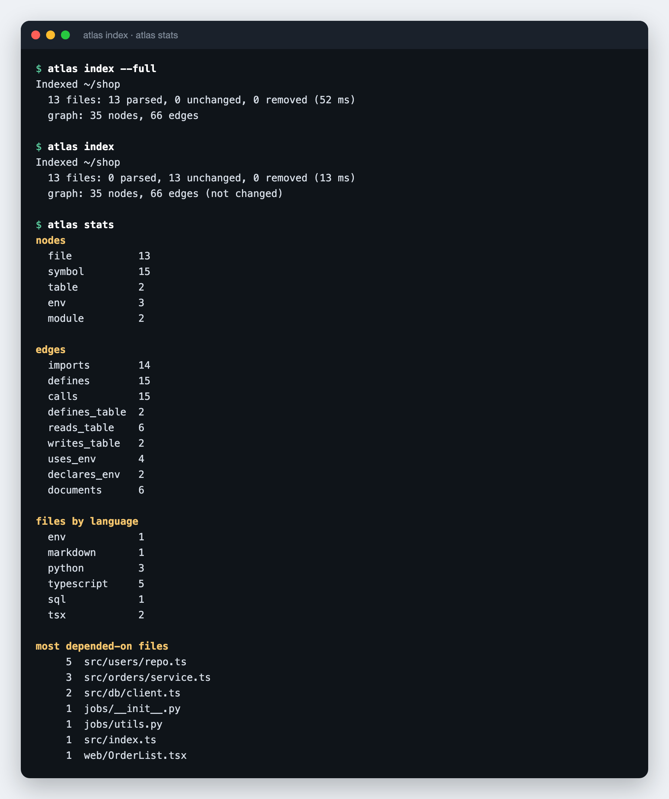
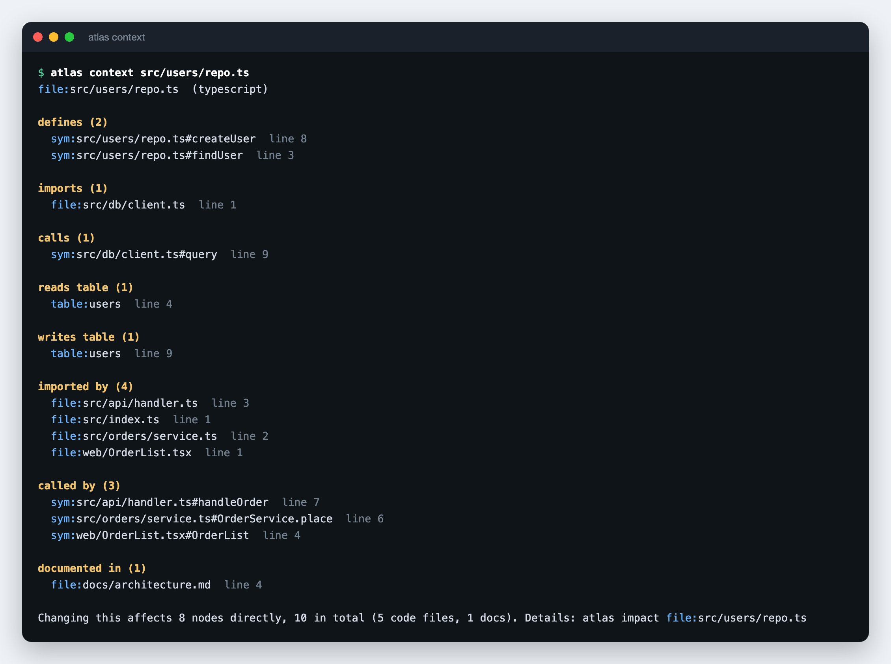
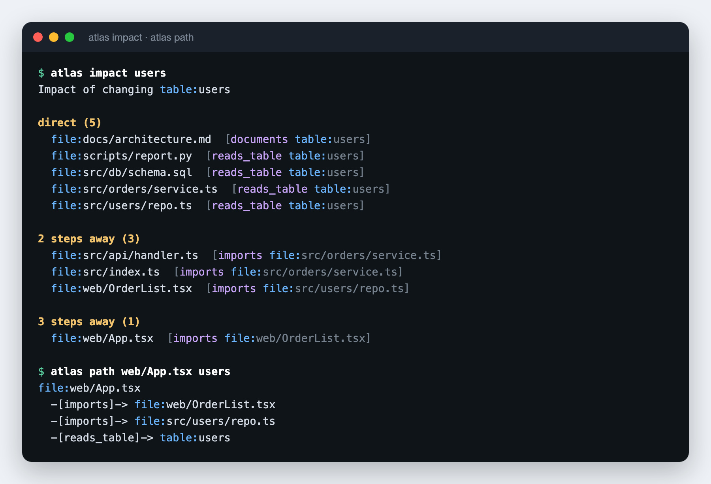
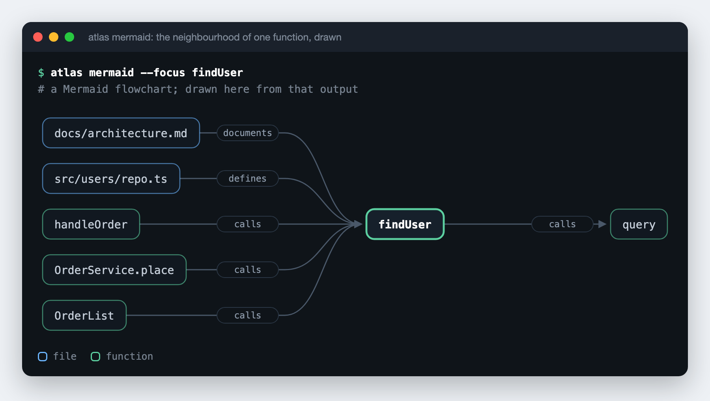
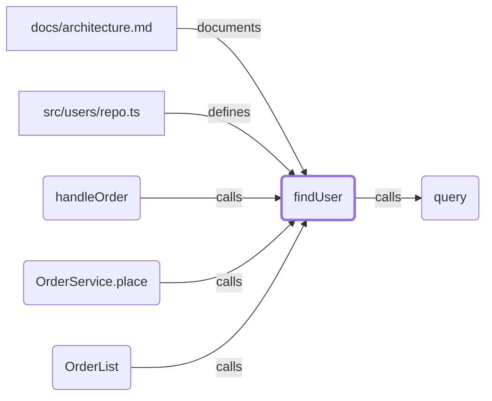
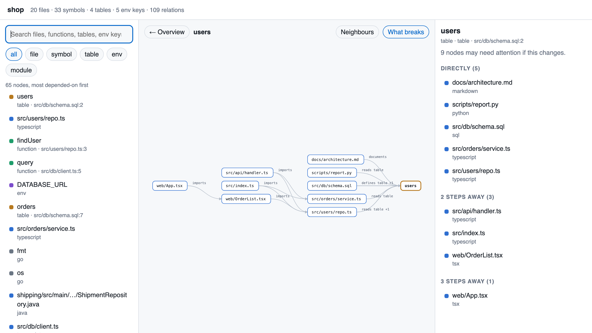
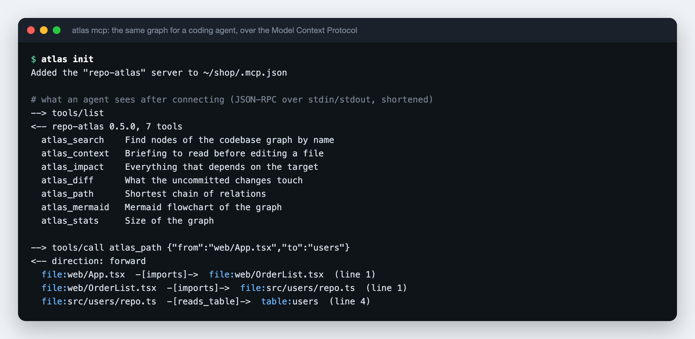
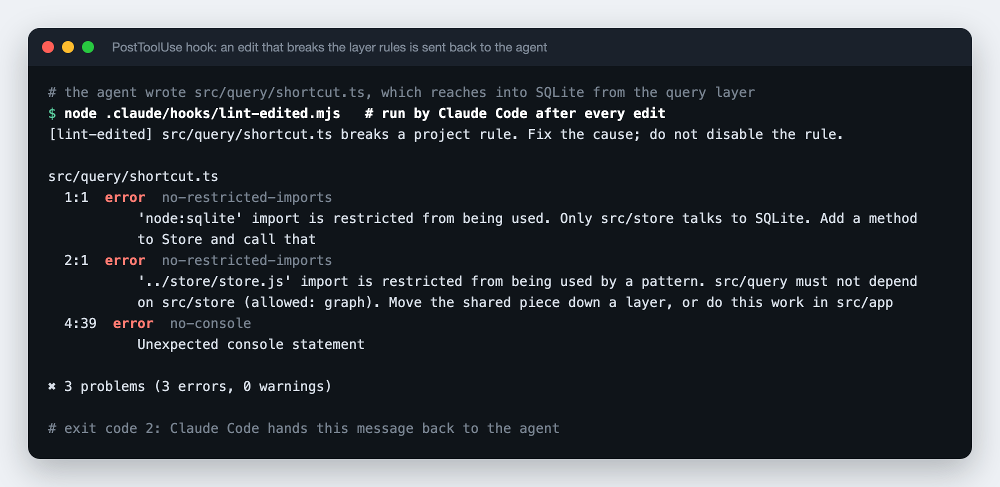

# Repo Atlas

**English** · [KOREAN](README.ko.md)

A local CLI that maps how the files, functions, SQL tables, env keys and docs of a repository relate, so that you or an AI coding agent can ask **"what does this touch, and what breaks if I change it?"** before editing.

> **Status: early development.**
> The free, local tier works end to end: index a repository (`atlas index`), ask for a briefing on a file (`atlas context`), trace what a change affects (`atlas impact`), draw the result (`atlas mermaid`), and let an agent ask the same questions over MCP (`atlas mcp`).
> It is on npm as [`repo-atlas-cli`](https://www.npmjs.com/package/repo-atlas-cli). Paid plans are still in planning.

**Jump to:** [Quick start](#quick-start) · [Usage](#usage) · [Use it from an AI agent](#use-it-from-an-ai-agent) · [Installation](#installation)

## Overview

Coding agents edit the wrong file when they miss a relation that is not visible from the file in front of them: a table that a Python job also reads, an env key three modules depend on, a function re-exported through a barrel file, a doc that describes the code being changed.

Repo Atlas keeps those relations in one queryable graph:

1. It parses the repository with tree-sitter and records, per file, the imports, functions, calls, SQL tables, env keys and doc references.
2. It links those facts into a graph stored in a local SQLite file (`.atlas/graph.db`).
3. The CLI and an MCP server answer questions from the graph: context, impact, path, diagram.

It is built for teams that maintain a large codebase and for people who work with AI coding agents.

### What it looks like

Every picture below is real output, captured from `fixtures/shop`, the small sample repository in this repo (TypeScript, TSX, Python, Go, Java, Rust, Ruby, SQL, Markdown). The only edit: the long folder path was shortened to `~/shop`.

**Index a repository** (Phases 1 and 2). The second run parses nothing, because no file changed:



**A briefing before editing a file** (Phase 3). What it defines and uses, who uses it, the tables it touches, the docs that mention it:



**What a change can break, and why two things are connected** (Phase 3). The `users` table is read from TypeScript and from a Python script, and a React component reaches it through two imports:



**The neighbourhood of one function as a diagram** (`atlas mermaid --focus findUser`). The command prints a Mermaid flowchart, which GitHub, GitLab and most editors render; this is that output, drawn:



<details>
<summary>The Mermaid output of the command</summary>



</details>

**The whole graph in a browser** (`atlas view`). One HTML file, written next to the index, with search, the neighbourhood of any node, and what breaks if it changes. It loads nothing from the network:



**The same graph for a coding agent** (Phase 4), over the Model Context Protocol:



**Rules enforced by tools, not by instructions** (Phase 0). An edit that reaches into SQLite from the wrong layer is sent straight back to the agent, with what to do instead:



## Features

| Feature                                                                                                                                                  | Status  |
| -------------------------------------------------------------------------------------------------------------------------------------------------------- | ------- |
| `atlas index`: tree-sitter extraction for TypeScript, TSX, JavaScript, Python, Go, Java, Rust and Ruby                                                   | Done    |
| SQL tables: `.sql` files and SQL inside string literals, split into defined / read / written                                                             | Done    |
| Env keys: `process.env.X`, `import.meta.env.X`, `os.environ`, `os.getenv`, `os.Getenv`, `System.getenv`, `env::var` / `env!`, `ENV["X"]` / `ENV.fetch`, and keys declared in `.env.example`                                           | Done    |
| Docs: Markdown links and backticked names that point at files, functions, tables or env keys                                                             | Done    |
| Import resolution: relative paths, `.js`→`.ts`, index files, tsconfig `paths` / `baseUrl`, workspace package names, Python packages and relative imports, Go module paths (`go.mod`), Java packages, Rust modules and crates (`Cargo.toml`), Ruby `require` and classes used by name| Done    |
| Call resolution through named, default and namespace imports, barrel re-exports, `this` / `self`, JSX components                                         | Done    |
| Incremental indexing: only changed files are re-parsed; every query refreshes the index first                                                            | Done    |
| `atlas context` / `impact` / `path` / `search` / `stats` / `export`, each with `--json`                                                                  | Done    |
| `atlas mermaid`: file overview or the neighbourhood of one node                                                                                          | Done    |
| `atlas view`: the graph as one HTML page to explore in a browser, with no server                                                                       | Done    |
| `atlas mcp`: MCP server (stdio) with six tools; `atlas init` registers it with Claude Code, VS Code, Cursor, Devin (Windsurf) or JetBrains               | Done    |
| Local SQLite index (built-in `node:sqlite`, nothing to compile)                                                                                          | Done    |
| Published npm package (`repo-atlas-cli`)                                                                                                                 | Done    |
| Paid plans: hosted indexing of private repositories, shared team graph, CI integration                                                                   | Planned |

### How it works

- **Extract**: each file is parsed on its own into plain facts (symbols, imports, calls, tables, env keys, doc references). Because a file's facts depend on that file only, unchanged files are never re-parsed.
- **Link**: the facts of all files are joined into nodes (`file`, `symbol`, `table`, `env`, `module`) and edges (`imports`, `defines`, `calls`, `defines_table`, `reads_table`, `writes_table`, `uses_env`, `declares_env`, `documents`). Linking is a pure function, checked with property-based tests: no dangling edges, no duplicates, same result regardless of file order.
- **Store**: facts and graph live in `.atlas/graph.db` in the repository, on **your own machine**. The folder ignores itself in git. Nothing leaves your computer.
- **Query**: `impact` walks dependency edges backwards. Paths through functions stay precise (callers of callers); a file reached through an import is followed to its own importers.
- **No AI inside**: the graph is built by parsing, not by a model. Repo Atlas needs no API key and makes no network requests.

### What gets indexed

| Kind                    | Files                                                 | What is recorded                                                                                                           |
| ----------------------- | ----------------------------------------------------- | -------------------------------------------------------------------------------------------------------------------------- |
| TypeScript / JavaScript | `.ts` `.tsx` `.mts` `.cts` `.js` `.jsx` `.mjs` `.cjs` | top-level functions, classes, methods; imports, re-exports, `require` and `module.exports`, dynamic `import()`; calls, `new`, JSX components    |
| Python                  | `.py`                                                 | functions, classes, methods; `import` / `from … import`; calls; `__tablename__`                                            |
| Go                      | `.go`                                                 | functions, methods, types; imports resolved through `go.mod`; calls, also on typed values and struct fields |
| Java                    | `.java`                                               | classes, interfaces, enums, records and their methods; imports and same-package use; calls through fields, parameters and inheritance; `@Table` |
| Rust                    | `.rs`                                                 | functions, structs, enums, traits and `impl` methods; `mod` and `use` paths, globs, `pub use`; calls by path, on typed values and inside macros |
| Ruby                    | `.rb` `.rake`                                         | classes, modules and their methods, top-level methods; `require`, `require_relative`, `autoload`, and classes used by name; calls on `self`, on a class, and on values made with `.new`; `create_table`, Active Record model tables |
| SQL                     | `.sql`, and SQL in code strings                       | `CREATE` / `ALTER` / `INSERT` / `UPDATE` / `DELETE` / `FROM` / `JOIN` / `REFERENCES`, plus `.from("table")` query builders |
| Config                  | `.env.example`, `.env.sample`, `.env.template`        | key names only, never values. Real `.env` files are never opened.                                                          |
| Docs                    | `.md` `.mdx`                                          | relative links and `` `backticked` `` names                                                                                |

Inside a git repository the file list comes from git, so `.gitignore` is honoured and a committed `build/` or `vendor/` folder is indexed like any other source (`node_modules` never is). Elsewhere, common output folders (`node_modules`, `dist`, `.venv`, …) are skipped. Files over 1 MiB are skipped.

## Requirements

- Node.js **22.13 or newer** (developed on Node 24). The built-in SQLite module needs it.
- [pnpm](https://pnpm.io) 10, only to build from source
- Git (optional; used to list files and to find the repository root)

## Installation

```bash
npm install -g repo-atlas-cli
atlas --version
```

The package is named `repo-atlas-cli`; the command it installs is `atlas`. To try it without installing, use `npx repo-atlas-cli index`.

To build from source instead:

```bash
git clone https://github.com/Trapa-Eureka/repo-atlas.git
cd repo-atlas
pnpm install
pnpm build
alias atlas='node /path/to/repo-atlas/dist/cli/main.js'   # adjust the path
```

## Quick start

You need the build from [Installation](#installation) and the `atlas` alias. Then, in any repository:

1. **Index it.** `cd your-project`, then `atlas index`. This creates `.atlas/` (git-ignored by itself, on your machine only).
2. **Ask before you edit.** `atlas context src/some/file.ts` shows what the file defines, what it uses, who uses it, the tables and env keys it touches, and the docs that mention it.
3. **Check the blast radius.** `atlas impact <file | function | table | ENV_KEY>` lists everything that depends on it.
4. **Give it to your agent.** `atlas init` registers the MCP server in `.mcp.json` (`--client` picks another agent); restart the agent. See [Use it from an AI agent](#use-it-from-an-ai-agent).

You do not need to re-run `atlas index`: every command first re-parses the files that changed since the last run.

## Usage

Every command accepts `-C <dir>` (work on another repository), `--json` (machine-readable output) and `--no-refresh` (answer from the stored index without checking for changes).

| I want to...                                  | Command                                                                      |
| --------------------------------------------- | ---------------------------------------------------------------------------- |
| build or update the index                     | `atlas index [dir]` (`--full` re-parses everything)                          |
| find a node by name                           | `atlas search <query> [--kind file\|symbol\|table\|env\|module] [--limit n]` |
| list every table (or env key)                 | `atlas search "" --kind table`                                               |
| get a briefing before editing something       | `atlas context <target>`                                                     |
| see what a change can break                   | `atlas impact <target> [--depth n]`                                          |
| understand how two things are connected       | `atlas path <from> <to>`                                                     |
| draw the file-level overview                  | `atlas mermaid [--max n] [-o graph.mmd]`                                     |
| draw the surroundings of one node             | `atlas mermaid --focus <target> [--depth n]`                                 |
| explore the graph in a browser                | `atlas view [--focus <target>] [--open] [-o page.html]`                      |
| see graph size, hub files, unresolved imports | `atlas stats [--unresolved]`                                                 |
| dump the whole graph                          | `atlas export [-o graph.json]`                                               |

### Targets

A `<target>` can be:

- a file path, from the repository root or from where you are: `src/users/repo.ts`, or just its tail `users/repo.ts`
- a function, class or method name: `findUser`, `OrderService.place`
- a symbol in a specific file: `src/users/repo.ts#findUser`
- a table, env key or package name: `users`, `DATABASE_URL`, `react`
- a node id printed by any command: `sym:src/users/repo.ts#findUser`, `table:users`

When a name matches more than one node, the command prints the candidates and exits with code `2`; pick one of the ids. Other errors exit with `1`.

### Reading `impact`

Each line ends with the reason the node is listed: `[calls X]`, `[imports X]`, `[reads_table X]`, `[documents X]`. `[contains X]` marks the file that holds an affected function. Docs that mention an affected node are listed so you can update them, and are not followed further.

### Develop this repository

```bash
pnpm check        # typecheck + lint + tests + hook tests: what a change must pass
pnpm build        # compile to dist/
pnpm test         # extractor, linker (property-based), CLI and MCP tests
pnpm test:hooks   # tests for the dev-time hooks
```

## Use it from an AI agent

`atlas mcp` runs a [Model Context Protocol](https://modelcontextprotocol.io) server on stdin/stdout. Register it once per repository:

```bash
atlas init                    # adds "repo-atlas" to .mcp.json, keeping other servers
atlas init --client cursor    # or: vscode, devin (also as windsurf), jetbrains
```

| Agent                  | `--client`          | What `atlas init` does                                                  | Then                                                                                         |
| ---------------------- | ------------------- | ----------------------------------------------------------------------- | -------------------------------------------------------------------------------------------- |
| Claude Code            | `claude` (default)  | writes `.mcp.json`                                                      | restart; it asks once whether to trust the server                                            |
| VS Code (Copilot)      | `vscode`            | writes the same `.mcp.json`                                             | turn on the setting `chat.mcp.workspaceRootConfig.enabled`; check with **MCP: List Servers** |
| Cursor                 | `cursor`            | writes `.cursor/mcp.json`                                               | turn the server on under **Customize**                                                       |
| Devin Local (Windsurf) | `devin`, `windsurf` | writes `.devin/mcp_config.json`                                         | open **Customize > MCPs** and refresh                                                        |
| JetBrains AI Assistant | `jetbrains`         | prints the entry; JetBrains keeps no file for it in the repository      | paste it under **Settings > Tools > AI Assistant > Model Context Protocol (MCP) > Add**      |

Each file is the one that product's documentation names for a repository, and it is written in the folder `atlas` works on (the repository root, or `-C`); `atlas init` does not look for settings anywhere else. A file that is not valid JSON is left as it is and reported. Windsurf's documentation now leads to Devin Local, so `windsurf` writes the Devin file. Only the Claude Code setup has been run end to end here; the others follow the documentation as of November 2026 and are checked for the file they write, not inside each editor.

To add the server by hand, this is the entry (`"type": "stdio"` is what VS Code and Cursor ask for; the others do not need it):

```json
{
  "mcpServers": {
    "repo-atlas": { "type": "stdio", "command": "atlas", "args": ["mcp"] }
  }
}
```

The `atlas` command must be on the agent's `PATH`; when running from source, replace `"command": "atlas", "args": ["mcp"]` with `"command": "node", "args": ["/path/to/repo-atlas/dist/cli/main.js", "mcp"]`.

| Tool            | Answers                                                                    |
| --------------- | -------------------------------------------------------------------------- |
| `atlas_search`  | which nodes have this name?                                                |
| `atlas_context` | what should I know before editing this?                                    |
| `atlas_impact`  | what depends on this, and which docs mention it?                           |
| `atlas_path`    | how are these two connected?                                               |
| `atlas_mermaid` | draw this part of the graph                                                |
| `atlas_stats`   | how big is the graph, which files are hubs, which imports did not resolve? |

Each tool call first re-indexes changed files, so the answers match the working tree the agent is editing. Agents without MCP can call the CLI with `--json` instead.

## Known limitations

- **Calls are resolved by name through imports, not by a type checker.** What the file itself says is followed: a variable made with `new`, a variable, parameter or class field with a class written as its type, `this.field.method()`, inherited methods and `super`, names taken out of an imported object (`const { parse } = db`), and CommonJS `require` / `module.exports`. A method on a value whose type has to be inferred (the result of a call, an untyped parameter), a `require()` or `import()` inside a function, a chained call (`a.b().c()`) and dynamic dispatch are not followed. Calls that cannot be resolved are left out instead of guessed, so the graph misses edges rather than inventing them.
- **SQL detection is pattern-based.** It reads SQL text. Queries built by concatenation or by an ORM (Prisma, Drizzle, SQLAlchemy expressions) are not seen. A `.from("name")` call on an instance is treated as a table read, which can be wrong for a library that is not a query builder. A name defined as a CTE (`WITH recent AS (...)`) anywhere in a file is never counted as a table in that file, because code often defines a CTE in one string and reads it in another; a real table with the same name loses its reads from that file.
- tsconfig `extends` is not followed, and `package.json` `exports` maps are not read; workspace packages are resolved to `src/index`, `index` or their `main` file.
- **Go: a folder is a package.** An import of a package inside the repository becomes edges to the files that declare what the importer uses (a constant, a function, or a type together with the files holding its methods; all of the package's files when a name cannot be placed). Methods are followed on values whose type is written (parameters, receivers, `var x T`, `x := T{}`, struct fields, embedded types) and on what a function of the repository returns (`x := NewT()`, `x, err := pkg.Open()`, `a.Open().Read()`: the first type the function returns), not through an interface, a field of a returned value, or a value assigned with `=` after it was declared. A type conversion (`ID(x)`) is not a call. Build tags are ignored, so two files that declare the same name for different platforms are not told apart, and `vendor/` folders written by `go mod vendor` are skipped. Checked on four public Go repositories (gin, cobra, miniflux, pocketbase: 1,037 Go files): 86 sampled edges were all correct and no local import was left unresolved. Missing edges were measured against the Go type checker (see below).
- **Java: a class is found by its package and name**, wherever its file is. A file depends on the file of every class it names, imported or not, since classes of the same package need no import. Methods are followed on fields, parameters and locals by their declared type, through superclasses and interfaces, and for static calls (`Labels.format()`); a call on an interface-typed value links to the interface's method, not to its implementations. `super(...)` in a constructor is a use of the parent class, and a class named only for a constant (`Limits.MAX`) is a class the file depends on. A method is also followed on what a call gives: `new T().run()`, a chain (`Builder.start().name(..).build()`), and a `var` made by a call, each looked up on the class the method before it says it returns. Not followed: a call through a field of another object (`a.b.c()`), a method that returns a type parameter or a collection, overloads that return different classes (all overloads share one symbol), calls with no receiver inside an anonymous class, reflection, and annotation-driven wiring. `@Table(name = ...)` defines a table; a non-native `@Query` is JPQL and is not read as SQL. Checked on four public Java repositories (spring-petclinic, gson, jsoup, commons-lang: 1,181 Java files): of 103 sampled edges one was wrong (a JPQL entity name read as a table) and has been fixed. Missing edges were measured against the Java compiler (see below).
- **Rust: paths are followed through the module tree.** `mod x;` and every `use` become edges to the file the path leads to (the file that declares the item, when `pub use` passes it on), across `crate::`, `self::`, `super::`, globs and other crates of the repository named in a `Cargo.toml`. Calls are followed by path (`a::b::f()`, `Type::new()`), on `self`, on `self.field`, and on a value whose type is written: a typed parameter, `let x: T`, `let x = T { .. }`, or `let x = T::open()` where `open` returns a `T` (with `?` when it returns a `Result` or an `Option` of one). A method comes from an `impl` in the type's file or the calling file, or from a trait implemented for the type in its own file. A method is also followed on what a function or method of the repository returns: a variable made by a call (`let x = make()`, `let x = a.open().await?`) and a call on a call (`Test::new().arg(..).run()`), where `Result` and `Option` give their value only after `?`, `.unwrap()` or `.expect(..)`. Not followed: values whose type is inferred any other way (a closure parameter, a pattern, a field of a returned value), generics beyond a single trait bound, `impl` blocks in a third file, macros that define items, and `#[path]` or `cfg` attributes. Items of an inline `mod name { }` are named as if they were at the top of the file, and of two `impl` blocks that define the same method name for one type only the first is kept. Inside a macro only `name(...)` and `path::name(...)` calls are seen. Checked on four public Rust repositories (fd, mini-redis, ripgrep, just: 432 Rust files): 102 sampled edges were all correct and no `use` was left unresolved. Missing edges were estimated from a sample read by hand (see below).
- **Ruby: a class is found by its name**, because most Ruby code is loaded by name and not by `require` (Rails autoloading, one `require` at the top of a gem). A file depends on the file of every class, module and constant it names, looked up through the namespaces around the mention, as Ruby does. A class opened in several files is placed in the file named after it (`Shop::Order` in `shop/order.rb`); a constant read through a class (`Order::LIMIT`) is placed in the file that assigns it, also when the class gets it from a parent or an included module. `require` is matched against `lib/`, `test/` and `spec/` folders; any other name is an outside gem. Calls are followed with no receiver or on `self` (through the superclass and `include` / `extend` / `prepend`), on a class (`Order.find`), and on a value the file makes with `.new`: a local, an instance variable, or an `attr_reader` of one. Instance methods and class methods of one class share a name, so `Order.total` stands for both `def total` and `def self.total`. Not followed: a method on a parameter or on the result of a call, `send` and `method_missing`, methods that code generates (`define_method`, `delegate`, Rails associations and scopes), and a `require` whose path is computed. A module that only wraps other classes is a namespace, not a symbol. An Active Record model reads the table its name gives it by convention, only when the repository defines a table of that name (`create_table` in `db/schema.rb` or a migration); queries written with Active Record methods (`User.where(...)`) are not read as table use. Checked on four public Ruby repositories (sinatra, jekyll, lobsters, mastodon: 4,199 Ruby files; the largest, 4,302 files in all, took about 4 s). A first round of samples turned up four kinds of wrong edge, all fixed since: a table read out of an interpolated `ALTER TABLE #{name}`, a CTE with a column list read as a table, a namespaced model given the unprefixed table, and a class of a gem placed in the file that reopens the gem's module. Of 120 edges sampled after that, all were correct. Missing edges were estimated from a sample read by hand (see below).
- A Python absolute import is matched from the repository root, then by a unique path suffix. Two packages with the same module path are left unresolved.
- Docs are linked only through relative links and backticked names. A backticked common word that happens to be the only function of that name will be linked; this is the least reliable kind of edge (see the numbers below).
- Only top-level functions, classes and their methods (including arrow functions assigned to class properties) are symbols. Nested functions are attributed to the function that contains them, and the members of a plain object are not symbols.
- **Measured accuracy is a sample, not a proof.** Ten public repositories were indexed (express, flask, httpx, got, swr, hono, datasette, full-stack-fastapi-template, umami, trpc: 4,903 files, about 55,000 relations; the largest, 1,741 files, took about 2 s). 180 randomly drawn edges were checked by hand against the source: calls 40/40, imports 30/30, table edges 40/40, env edges 29/30, doc edges 38/40. Of roughly 12,000 local imports, 70 were left unresolved; 67 of those point at files that are not in the repository (generated clients, build output). That sample measures wrong edges only. When call resolution was later extended (it added about 1,000 call edges on these repositories), 45 of the added edges were checked the same way and all were correct.
- **Missing edges, measured against the TypeScript compiler.** On the seven of those repositories that contain TypeScript or JavaScript, every call and import the compiler could resolve to a file of the repository was looked up in the graph (`scripts/recall.mjs`). Imports: 10,521 of 10,527 found (99.9%). Calls: 12,622 of 15,312 found (82.4%), or 90.8% when calls to nested functions, which are not symbols by design, are left out. What is still missed, largest first: methods called on a value whose type has to be inferred or through a chain, targets that are not symbols (anonymous functions, members of plain objects, variables holding a function), and a remainder of functions reached under another name. The repositories were not installed, so calls the compiler could not resolve without their dependencies are outside this count, and Python was not measured.
- **Missing edges in Java, measured against `javac`.** On the four Java repositories above, every call and every class name that `javac` could resolve to a declaration in the repository was looked up in the graph (`scripts/recall-java.mjs`). Files that depend on the file of a class they name: 4,602 of 4,652 found (98.9%); it was 95.9% until a class named only for a constant (`StringUtils.EMPTY`) was counted as a use. Calls: 13,083 of 13,795 found (94.8%). The first measurement found 87.5%, with a call on the result of a call as the largest miss; following what a method returns added 4,088 call edges on these repositories, of which 45 were checked by hand and all were correct, and `super(...)` in a constructor is now a use of the parent class. What is still missed, largest first: a chain that passes a field, a type parameter or a collection (403), and a method on a variable or a field whose type the file does not write out, as in a lambda parameter (170). The repositories were not built, so calls `javac` could not resolve without their dependencies (anything inside a JUnit assertion's unresolved overload, a value of a library type) are outside this count, as are calls into the JDK, one overload calling another, which is one symbol in the graph, and the `super()` that the compiler puts into a constructor that does not write one. Rust and Ruby were estimated from samples instead (below).
- **Missing edges in Go, measured against the Go type checker.** On the four Go repositories above, every call the type checker resolved to a function or method declared in the repository, and every name of another package of the repository, was looked up in the graph (`scripts/recall-go.mjs`). Files that depend on the file of another package that declares what they use: 2,332 of 2,332 found. Calls: 8,604 of 10,394 found (82.8%), or 89.5% when calls of an interface's method, which are decided at run time, are left out. The first measurement found 59.8%: Go code rarely writes the type of a local, and a method on a variable made by a call (`client := NewClient()`, then `client.Send()`) was not followed. Following what a function returns added 4,631 call edges on these repositories; 45 of them were checked by hand and all were correct. What is still missed is a method of an interface (775), a call through a chain that passes a field or an interface (704) and a method on a variable whose type still cannot be told (278). Calls into the standard library and other modules, and calls of a function held in a variable or a field, are outside this count.
- **Missing edges in Rust, estimated by hand.** Asking the Rust compiler would have meant building each repository's dependencies, so a sample was read instead: 120 call sites drawn at random from the 25,192 in the four Rust repositories whose name matches a function of the repository. 25 called something outside the repository (`Vec::push`, `Command::arg`). Of the 95 that called a function or method of the repository, the graph had 47 (49%) at first: 37 of the 48 misses were one form, a method called on the result of a call, which builder-style code is made of (`Test::new().justfile(..).arg(..).stdout(..)`, most of them in the tests of one repository). After the graph learned to follow what a function returns, the same 95 were looked up again and it had 87 (92%); that change added 8,238 call edges on the four repositories, of which 89 were checked by hand and all were correct. The 8 still missed are a function reached through a re-exporting module or crate (3), a method on a value whose type still cannot be told (2: one bound by a closure, one whose type is named through an inline module), and one each of a nested function, a method reached through `Deref`, and a method a trait adds to a type of another crate. A sample of 95 gives a rough figure, not a measurement, and it leans on one repository's tests: the true share is likely somewhere between 85% and 97%, and lower for code with fewer builders.
- **Missing edges in Ruby, estimated by hand.** Ruby has no compiler to ask, so a sample was read the same way as for Rust: 120 call sites drawn at random from the 71,684 in the four Ruby repositories whose method name matches a method of the repository. 71 called something outside it (Rails, RSpec, the core library: `expect(..).to`, `context`, `record.id`). Of the 49 that called a method of the repository, the graph had 24 (49%). 18 of the 25 misses are a method on a value whose class the file never states: a parameter, a block parameter, an RSpec `let` or `subject`, an instance variable filled from a call (`recipient.requested?(sender)`). 5 are a method on the result of a call, and 2 are methods that reach the caller through test configuration or `instance_eval`. Calls written as a bare name with no arguments, which the graph follows well, were not in the sampling frame, so this is on the low side; and 49 calls is a small sample, so the true share is likely somewhere between 35% and 65%.
- Developed on macOS; Linux should work, Windows is untested. Node's built-in SQLite is still marked experimental by Node; `atlas` hides its startup warning.

## Paid plans (planned)

Everything that runs on your machine is free and stays free: indexing, every query, diagrams, the MCP server. Paid plans for features that need a server (hosted indexing of private repositories, a graph shared by a team, CI integration) are in planning. Nothing is for sale yet, and prices and details are not decided.

## Agent harness

This repository is developed with AI coding agents, and its rules are enforced by tools rather than by a long instruction file:

- **`CLAUDE.md` is short.** It holds only what the code cannot tell an agent.
- **Lint rules carry the architecture** (`eslint.config.js`): which layer may import which, and that only one layer may touch SQLite, tree-sitter, the argument parser or the MCP SDK. Each message says what to do instead.
- **Hooks** (`.claude/settings.json`, scripts and tests in `.claude/hooks/`):
  - `PreToolUse` blocks hard-to-reverse actions: broad recursive deletes, force pushes, `reset --hard`, staging secrets or index files, destructive SQL, `curl | sh`, `npm publish`, writing key-shaped strings into files.
  - `PostToolUse` lints the file that was just edited and returns violations to the agent (exit code 2).
  - `Stop` runs typecheck and tests when code changed, and will not let a turn end on a failure.
- **Deny rules** keep real env files unreadable and publishing in human hands.
- **Skills** (`.claude/skills/`) hold procedures that are only needed sometimes: adding a language, and proving a change with real CLI output.
- **A fresh-eyes reviewer** (`.claude/agents/fresh-reviewer.md`) reviews a change without having seen how it was written.

The hooks are a safety net, not a complete defense: they match command text, so a wrapped or obfuscated command can slip through, and an innocent command that merely contains a dangerous-looking string can be blocked.

## Data and privacy

- The index (`.atlas/`) stays on your machine. The folder contains its own `.gitignore`, so it is never committed by accident.
- The index holds file paths, symbol names, table names and env key **names**. It does not hold file contents or env values.
- Real env files (`.env`, `.env.local`, …) are never opened; only templates such as `.env.example` are read.
- `atlas view` writes a page that holds the same paths and names as the index. It goes to `.atlas/view.html` unless you pass `--out`; treat a copy you put elsewhere like the index itself.
- No telemetry, no network requests, no API keys.

## Project layout

```
repo-atlas/
├── src/
│   ├── graph/     # node and edge types, in-memory graph
│   ├── extract/   # one file -> facts (tree-sitter, SQL, env, Markdown)
│   ├── indexer/   # file listing, import aliases, linking facts into a graph, incremental index
│   ├── store/     # SQLite (the only module that knows SQL)
│   ├── query/     # search, context, impact, path, mermaid, stats (pure, over the in-memory graph)
│   ├── app/       # Atlas: what the CLI and the MCP server both call
│   ├── mcp/       # MCP server
│   └── cli/       # the `atlas` command
├── test/          # extractor, linker (property-based), CLI and MCP tests
├── fixtures/shop/ # sample repository indexed by the tests
├── assets/        # README screenshots and the social preview image
├── scripts/       # regenerate the images in assets/ (`pnpm screenshots`), measure missed edges (`recall.mjs`)
├── .claude/
│   ├── settings.json
│   ├── hooks/     # dev-time hooks and their tests
│   ├── skills/    # add-language, verify-change
│   └── agents/    # fresh-reviewer
├── CLAUDE.md      # short guidance for AI agents working in this repo
└── eslint.config.js  # layer boundaries
```

### Tech stack

TypeScript (ESM) on Node.js 22+ · [web-tree-sitter](https://github.com/tree-sitter/tree-sitter) with prebuilt WASM grammars (no native build) · built-in `node:sqlite` · [commander](https://github.com/tj/commander.js) · [MCP TypeScript SDK](https://github.com/modelcontextprotocol/typescript-sdk) · Vitest and [fast-check](https://github.com/dubzzz/fast-check) · ESLint · pnpm

## Roadmap

- [x] **Phase 0**: harness: short `CLAUDE.md`, hooks, lint-enforced layers, sample repository
- [x] **Phase 1**: extraction: TypeScript / JavaScript / Python, SQL, env keys, Markdown
- [x] **Phase 2**: graph: linking, SQLite store, incremental indexing
- [x] **Phase 3**: queries and CLI: `search`, `context`, `impact`, `path`, `mermaid`, `stats`, `export`
- [x] **Phase 4**: agents: MCP server, `atlas init`
- [x] **Phase 5**: release
  - [x] npm package ([`repo-atlas-cli`](https://www.npmjs.com/package/repo-atlas-cli))
  - [x] more languages
    - [x] Go
    - [x] Java
    - [x] Rust
    - [x] Ruby
  - [x] local HTML viewer (`atlas view`)
  - [x] setup for the agents inside editors (`atlas init --client`): VS Code, Cursor, Devin (Windsurf), JetBrains
- [ ] **Phase 6**: paid plans: hosted private-repository indexing, shared team graph, CI integration (planned)

## Contributing

The project is at an early stage. Please open an issue to discuss a change before sending a pull request. All files in this repository are written in English; `README.ko.md` is a Korean translation, and this file is the source of truth.

## License

[MIT](LICENSE).
