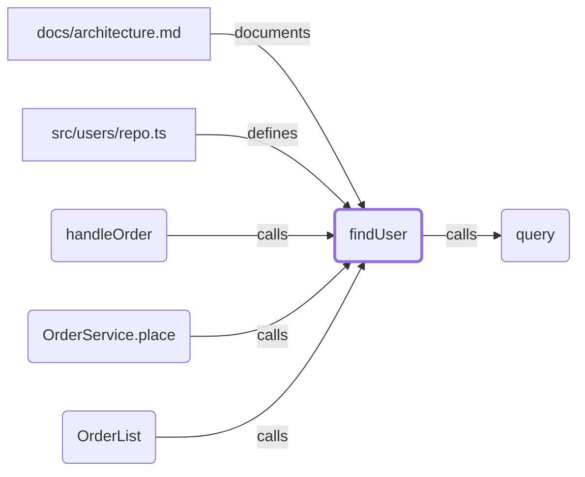

# Repo Atlas

**English** · [KOREAN](README.ko.md)

A local CLI that maps how the files, functions, SQL tables, env keys and docs of a repository relate, so that you or an AI coding agent can ask **"what does this touch, and what breaks if I change it?"** before editing.

> **Status: early development.**
> The free, local tier works end to end: index a repository (`atlas index`), ask for a briefing on a file (`atlas context`), trace what a change affects (`atlas impact`), draw the result (`atlas mermaid`), and let an agent ask the same questions over MCP (`atlas mcp`).
> It is on npm as [`repo-atlas-cli`](https://www.npmjs.com/package/repo-atlas-cli). Paid plans are still in planning.

**Jump to:** [Quick start](#quick-start) · [Usage](#usage) · [Use it from an AI agent](#use-it-from-an-ai-agent) · [Installation](#installation)

## Overview

Coding agents edit the wrong file when they miss a relation that is not visible from the file in front of them: a table that a Python job also reads, an env key three modules depend on, a function re-exported through a barrel file, a doc that describes the code being changed.

Repo Atlas keeps those relations in one queryable graph:

1. It parses the repository with tree-sitter and records, per file, the imports, functions, calls, SQL tables, env keys and doc references.
2. It links those facts into a graph stored in a local SQLite file (`.atlas/graph.db`).
3. The CLI and an MCP server answer questions from the graph: context, impact, path, diagram.

It is built for teams that maintain a large codebase and for people who work with AI coding agents.

### What it looks like

Every picture below is real output, captured from `fixtures/shop`, the small sample repository in this repo (TypeScript, TSX, Python, SQL, Markdown). The only edit: the long folder path was shortened to `~/shop`.

**Index a repository** (Phases 1 and 2). The second run parses nothing, because no file changed:


**A briefing before editing a file** (Phase 3). What it defines and uses, who uses it, the tables it touches, the docs that mention it:


**What a change can break, and why two things are connected** (Phase 3). The `users` table is read from TypeScript and from a Python script, and a React component reaches it through two imports:


**The neighbourhood of one function as a diagram** (`atlas mermaid --focus findUser`), which GitHub renders directly:



**The same graph for a coding agent** (Phase 4), over the Model Context Protocol:


**Rules enforced by tools, not by instructions** (Phase 0). An edit that reaches into SQLite from the wrong layer is sent straight back to the agent, with what to do instead:


## Features

| Feature                                                                                                                                                  | Status  |
| -------------------------------------------------------------------------------------------------------------------------------------------------------- | ------- |
| `atlas index`: tree-sitter extraction for TypeScript, TSX, JavaScript and Python                                                                         | Done    |
| SQL tables: `.sql` files and SQL inside string literals, split into defined / read / written                                                             | Done    |
| Env keys: `process.env.X`, `import.meta.env.X`, `os.environ`, `os.getenv`, and keys declared in `.env.example`                                           | Done    |
| Docs: Markdown links and backticked names that point at files, functions, tables or env keys                                                             | Done    |
| Import resolution: relative paths, `.js`→`.ts`, index files, tsconfig `paths` / `baseUrl`, workspace package names, Python packages and relative imports | Done    |
| Call resolution through named, default and namespace imports, barrel re-exports, `this` / `self`, JSX components                                         | Done    |
| Incremental indexing: only changed files are re-parsed; every query refreshes the index first                                                            | Done    |
| `atlas context` / `impact` / `path` / `search` / `stats` / `export`, each with `--json`                                                                  | Done    |
| `atlas mermaid`: file overview or the neighbourhood of one node                                                                                          | Done    |
| `atlas mcp`: MCP server (stdio) with six tools; `atlas init` registers it in `.mcp.json`                                                                 | Done    |
| Local SQLite index (built-in `node:sqlite`, nothing to compile)                                                                                          | Done    |
| Published npm package (`repo-atlas-cli`)                                                                                                                 | Done    |
| More languages (Go, Rust, Java, Ruby: the grammars already ship with the dependency)                                                                     | Planned |
| IDE integration                                                                                                                                          | Planned |
| Paid plans: hosted indexing of private repositories, shared team graph, CI integration                                                                   | Planned |

### How it works

- **Extract**: each file is parsed on its own into plain facts (symbols, imports, calls, tables, env keys, doc references). Because a file's facts depend on that file only, unchanged files are never re-parsed.
- **Link**: the facts of all files are joined into nodes (`file`, `symbol`, `table`, `env`, `module`) and edges (`imports`, `defines`, `calls`, `defines_table`, `reads_table`, `writes_table`, `uses_env`, `declares_env`, `documents`). Linking is a pure function, checked with property-based tests: no dangling edges, no duplicates, same result regardless of file order.
- **Store**: facts and graph live in `.atlas/graph.db` in the repository, on **your own machine**. The folder ignores itself in git. Nothing leaves your computer.
- **Query**: `impact` walks dependency edges backwards. Paths through functions stay precise (callers of callers); a file reached through an import is followed to its own importers.
- **No AI inside**: the graph is built by parsing, not by a model. Repo Atlas needs no API key and makes no network requests.

### What gets indexed

| Kind                    | Files                                                 | What is recorded                                                                                                           |
| ----------------------- | ----------------------------------------------------- | -------------------------------------------------------------------------------------------------------------------------- |
| TypeScript / JavaScript | `.ts` `.tsx` `.mts` `.cts` `.js` `.jsx` `.mjs` `.cjs` | top-level functions, classes, methods; imports, re-exports, `require`, dynamic `import()`; calls, `new`, JSX components    |
| Python                  | `.py`                                                 | functions, classes, methods; `import` / `from … import`; calls; `__tablename__`                                            |
| SQL                     | `.sql`, and SQL in code strings                       | `CREATE` / `ALTER` / `INSERT` / `UPDATE` / `DELETE` / `FROM` / `JOIN` / `REFERENCES`, plus `.from("table")` query builders |
| Config                  | `.env.example`, `.env.sample`, `.env.template`        | key names only, never values. Real `.env` files are never opened.                                                          |
| Docs                    | `.md` `.mdx`                                          | relative links and `` `backticked` `` names                                                                                |

Inside a git repository the file list comes from git, so `.gitignore` is honoured and a committed `build/` or `vendor/` folder is indexed like any other source (`node_modules` never is). Elsewhere, common output folders (`node_modules`, `dist`, `.venv`, …) are skipped. Files over 1 MiB are skipped.

## Requirements

- Node.js **22.13 or newer** (developed on Node 24). The built-in SQLite module needs it.
- [pnpm](https://pnpm.io) 10, only to build from source
- Git (optional; used to list files and to find the repository root)

## Installation

```bash
npm install -g repo-atlas-cli
atlas --version
```

The package is named `repo-atlas-cli`; the command it installs is `atlas`. To try it without installing, use `npx repo-atlas-cli index`.

To build from source instead:

```bash
git clone https://github.com/Trapa-Eureka/repo-atlas.git
cd repo-atlas
pnpm install
pnpm build
alias atlas='node /path/to/repo-atlas/dist/cli/main.js'   # adjust the path
```

## Quick start

You need the build from [Installation](#installation) and the `atlas` alias. Then, in any repository:

1. **Index it.** `cd your-project`, then `atlas index`. This creates `.atlas/` (git-ignored by itself, on your machine only).
2. **Ask before you edit.** `atlas context src/some/file.ts` shows what the file defines, what it uses, who uses it, the tables and env keys it touches, and the docs that mention it.
3. **Check the blast radius.** `atlas impact <file | function | table | ENV_KEY>` lists everything that depends on it.
4. **Give it to your agent.** `atlas init` registers the MCP server in `.mcp.json`; restart the agent. See [Use it from an AI agent](#use-it-from-an-ai-agent).

You do not need to re-run `atlas index`: every command first re-parses the files that changed since the last run.

## Usage

Every command accepts `-C <dir>` (work on another repository), `--json` (machine-readable output) and `--no-refresh` (answer from the stored index without checking for changes).

| I want to...                                  | Command                                                                      |
| --------------------------------------------- | ---------------------------------------------------------------------------- |
| build or update the index                     | `atlas index [dir]` (`--full` re-parses everything)                          |
| find a node by name                           | `atlas search <query> [--kind file\|symbol\|table\|env\|module] [--limit n]` |
| list every table (or env key)                 | `atlas search "" --kind table`                                               |
| get a briefing before editing something       | `atlas context <target>`                                                     |
| see what a change can break                   | `atlas impact <target> [--depth n]`                                          |
| understand how two things are connected       | `atlas path <from> <to>`                                                     |
| draw the file-level overview                  | `atlas mermaid [--max n] [-o graph.mmd]`                                     |
| draw the surroundings of one node             | `atlas mermaid --focus <target> [--depth n]`                                 |
| see graph size, hub files, unresolved imports | `atlas stats [--unresolved]`                                                 |
| dump the whole graph                          | `atlas export [-o graph.json]`                                               |

### Targets

A `<target>` can be:

- a file path, from the repository root or from where you are: `src/users/repo.ts`, or just its tail `users/repo.ts`
- a function, class or method name: `findUser`, `OrderService.place`
- a symbol in a specific file: `src/users/repo.ts#findUser`
- a table, env key or package name: `users`, `DATABASE_URL`, `react`
- a node id printed by any command: `sym:src/users/repo.ts#findUser`, `table:users`

When a name matches more than one node, the command prints the candidates and exits with code `2`; pick one of the ids. Other errors exit with `1`.

### Reading `impact`

Each line ends with the reason the node is listed: `[calls X]`, `[imports X]`, `[reads_table X]`, `[documents X]`. `[contains X]` marks the file that holds an affected function. Docs that mention an affected node are listed so you can update them, and are not followed further.

### Develop this repository

```bash
pnpm check        # typecheck + lint + tests + hook tests: what a change must pass
pnpm build        # compile to dist/
pnpm test         # extractor, linker (property-based), CLI and MCP tests
pnpm test:hooks   # tests for the dev-time hooks
```

## Use it from an AI agent

`atlas mcp` runs a [Model Context Protocol](https://modelcontextprotocol.io) server on stdin/stdout. Register it once per repository:

```bash
atlas init        # adds "repo-atlas" to .mcp.json, keeping other servers
```

or add it by hand:

```json
{
  "mcpServers": {
    "repo-atlas": { "command": "atlas", "args": ["mcp"] }
  }
}
```

The `atlas` command must be on the agent's `PATH`; when running from source, replace `"command": "atlas", "args": ["mcp"]` with `"command": "node", "args": ["/path/to/repo-atlas/dist/cli/main.js", "mcp"]`.

| Tool            | Answers                                                                    |
| --------------- | -------------------------------------------------------------------------- |
| `atlas_search`  | which nodes have this name?                                                |
| `atlas_context` | what should I know before editing this?                                    |
| `atlas_impact`  | what depends on this, and which docs mention it?                           |
| `atlas_path`    | how are these two connected?                                               |
| `atlas_mermaid` | draw this part of the graph                                                |
| `atlas_stats`   | how big is the graph, which files are hubs, which imports did not resolve? |

Each tool call first re-indexes changed files, so the answers match the working tree the agent is editing. Agents without MCP can call the CLI with `--json` instead.

## Known limitations

- **Calls are resolved by name through imports, not by type.** A method called on an instance (`const s = new Service(); s.run()`), a chained call (`a.b().c()`) and dynamic dispatch are not followed. Calls that cannot be resolved are left out instead of guessed, so the graph misses edges rather than inventing them.
- **SQL detection is pattern-based.** It reads SQL text. Queries built by concatenation or by an ORM (Prisma, Drizzle, SQLAlchemy expressions) are not seen. A `.from("name")` call on an instance is treated as a table read, which can be wrong for a library that is not a query builder. A name defined as a CTE (`WITH recent AS (...)`) anywhere in a file is never counted as a table in that file, because code often defines a CTE in one string and reads it in another; a real table with the same name loses its reads from that file.
- tsconfig `extends` is not followed, and `package.json` `exports` maps are not read; workspace packages are resolved to `src/index`, `index` or their `main` file.
- A Python absolute import is matched from the repository root, then by a unique path suffix. Two packages with the same module path are left unresolved.
- Docs are linked only through relative links and backticked names. A backticked common word that happens to be the only function of that name will be linked; this is the least reliable kind of edge (see the numbers below).
- Env keys are matched in the source text, so a key named inside a string or a comment counts as a use.
- Only top-level functions, classes and their methods are symbols. Nested functions are attributed to the function that contains them.
- **Measured accuracy is a sample, not a proof.** Ten public repositories were indexed (express, flask, httpx, got, swr, hono, datasette, full-stack-fastapi-template, umami, trpc: 4,903 files, about 54,000 relations; the largest, 1,741 files, took 1.6 s). 180 randomly drawn edges were checked by hand against the source: calls 40/40, imports 30/30, table edges 40/40, env edges 29/30, doc edges 38/40. Of roughly 12,000 local imports, 70 were left unresolved; 67 of those point at files that are not in the repository (generated clients, build output). This measures wrong edges only. Missing edges were not counted, and the first limitation above means there are many.
- Developed on macOS; Linux should work, Windows is untested. Node's built-in SQLite is still marked experimental by Node; `atlas` hides its startup warning.

## Paid plans (planned)

Everything that runs on your machine is free and stays free: indexing, every query, diagrams, the MCP server. Paid plans for features that need a server (hosted indexing of private repositories, a graph shared by a team, CI integration) are in planning. Nothing is for sale yet, and prices and details are not decided.

## Agent harness

This repository is developed with AI coding agents, and its rules are enforced by tools rather than by a long instruction file:

- **`CLAUDE.md` is short.** It holds only what the code cannot tell an agent.
- **Lint rules carry the architecture** (`eslint.config.js`): which layer may import which, and that only one layer may touch SQLite, tree-sitter, the argument parser or the MCP SDK. Each message says what to do instead.
- **Hooks** (`.claude/settings.json`, scripts and tests in `.claude/hooks/`):
  - `PreToolUse` blocks hard-to-reverse actions: broad recursive deletes, force pushes, `reset --hard`, staging secrets or index files, destructive SQL, `curl | sh`, `npm publish`, writing key-shaped strings into files.
  - `PostToolUse` lints the file that was just edited and returns violations to the agent (exit code 2).
  - `Stop` runs typecheck and tests when code changed, and will not let a turn end on a failure.
- **Deny rules** keep real env files unreadable and publishing in human hands.
- **Skills** (`.claude/skills/`) hold procedures that are only needed sometimes: adding a language, and proving a change with real CLI output.
- **A fresh-eyes reviewer** (`.claude/agents/fresh-reviewer.md`) reviews a change without having seen how it was written.

The hooks are a safety net, not a complete defense: they match command text, so a wrapped or obfuscated command can slip through, and an innocent command that merely contains a dangerous-looking string can be blocked.

## Data and privacy

- The index (`.atlas/`) stays on your machine. The folder contains its own `.gitignore`, so it is never committed by accident.
- The index holds file paths, symbol names, table names and env key **names**. It does not hold file contents or env values.
- Real env files (`.env`, `.env.local`, …) are never opened; only templates such as `.env.example` are read.
- No telemetry, no network requests, no API keys.

## Project layout

```
repo-atlas/
├── src/
│   ├── graph/     # node and edge types, in-memory graph
│   ├── extract/   # one file -> facts (tree-sitter, SQL, env, Markdown)
│   ├── indexer/   # file listing, import aliases, linking facts into a graph, incremental index
│   ├── store/     # SQLite (the only module that knows SQL)
│   ├── query/     # search, context, impact, path, mermaid, stats (pure, over the in-memory graph)
│   ├── app/       # Atlas: what the CLI and the MCP server both call
│   ├── mcp/       # MCP server
│   └── cli/       # the `atlas` command
├── test/          # extractor, linker (property-based), CLI and MCP tests
├── fixtures/shop/ # sample repository indexed by the tests
├── assets/        # README screenshots and the social preview image
├── scripts/       # regenerate the images in assets/ (`pnpm screenshots`)
├── .claude/
│   ├── settings.json
│   ├── hooks/     # dev-time hooks and their tests
│   ├── skills/    # add-language, verify-change
│   └── agents/    # fresh-reviewer
├── CLAUDE.md      # short guidance for AI agents working in this repo
└── eslint.config.js  # layer boundaries
```

### Tech stack

TypeScript (ESM) on Node.js 22+ · [web-tree-sitter](https://github.com/tree-sitter/tree-sitter) with prebuilt WASM grammars (no native build) · built-in `node:sqlite` · [commander](https://github.com/tj/commander.js) · [MCP TypeScript SDK](https://github.com/modelcontextprotocol/typescript-sdk) · Vitest and [fast-check](https://github.com/dubzzz/fast-check) · ESLint · pnpm

## Roadmap

- [x] **Phase 0**: harness: short `CLAUDE.md`, hooks, lint-enforced layers, sample repository
- [x] **Phase 1**: extraction: TypeScript / JavaScript / Python, SQL, env keys, Markdown
- [x] **Phase 2**: graph: linking, SQLite store, incremental indexing
- [x] **Phase 3**: queries and CLI: `search`, `context`, `impact`, `path`, `mermaid`, `stats`, `export`
- [x] **Phase 4**: agents: MCP server, `atlas init`
- [ ] **Phase 5**: release
  - [x] npm package ([`repo-atlas-cli`](https://www.npmjs.com/package/repo-atlas-cli))
  - [ ] more languages
  - [ ] IDE integration
- [ ] **Phase 6**: paid plans: hosted private-repository indexing, shared team graph, CI integration (planned)

## Contributing

The project is at an early stage. Please open an issue to discuss a change before sending a pull request. All files in this repository are written in English; `README.ko.md` is a Korean translation, and this file is the source of truth.

## License

[MIT](LICENSE).
